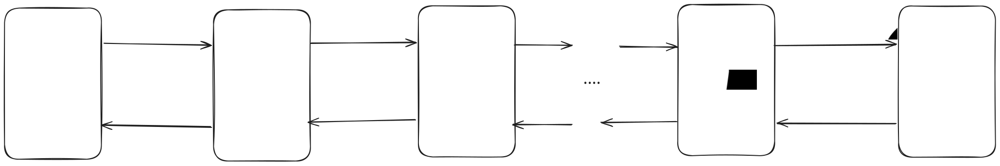

## 0 Hierachical HVAE
 _Figure 1: Hierachical Variational AutoEncoder_

## 1. Denoising Diffusion Probabilistic Models 
 _Figure 2: Denoising Diffusion Probabilistic Models: DDPMS consist of 2 component. where $q(.)$ is a fixed kernel adding gaussian noise to the data, and $p_\theta$ is a learned reverse process that try to generate new same from noise.

