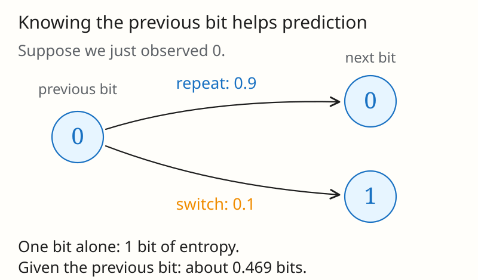
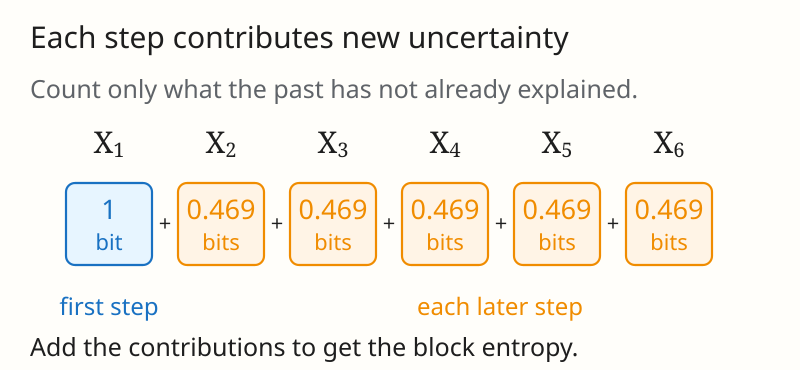
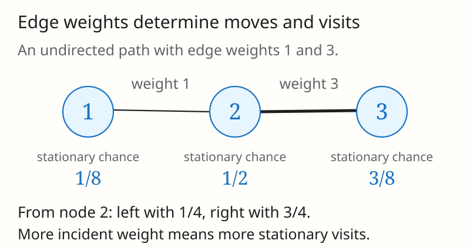
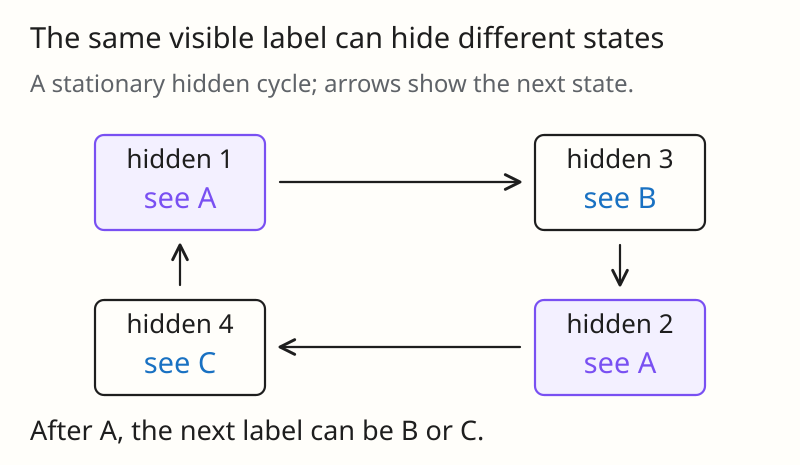

[[asymptotic-equipartition-property|Blog 3]] explained how to compress a long sequence of independent observations. Each observation adds the same average uncertainty, so $n$ observations contain $nH(X_1)$ bits of entropy.

Now suppose the observations depend on each other. Start with a fair random bit. At each step, repeat the previous bit with probability 0.9 and switch with probability 0.1. If you look at any one bit alone, 0 and 1 are equally likely. But if you know the previous bit, you can predict the next one correctly 90% of the time. Knowing the past reduces the uncertainty.

**How much new uncertainty does each step add?** This is what **entropy rate** measures. In this example it is about 0.469 bits per step, even though each bit viewed alone has one bit of entropy. We will explain how to calculate this rate and when it plays the same role in compression that single-symbol entropy played in Blog 3.


*Knowing the previous bit changes a 50/50 guess into a 90/10 prediction. The uncertainty of one isolated bit and the uncertainty of the next bit given the past are different quantities.*

> [!note] Notation used below
> All logarithms are base 2. $X_n$ is the observation at step $n$, and $X^n=(X_1,\ldots,X_n)$ is the first $n$ observations. We use $H(\mathcal{X})$ for the entropy rate of the whole process and $H(X_n)$ for the entropy of one observation. Other symbols are introduced when we need them. The alphabet is finite, and $0\log0=0$.

## 1. Stationary Processes and Markov Chains

A **stochastic process** is simply a sequence of random observations, such as successive coin flips or the changing location of a random walker. To describe it, we need both the probabilities of individual observations and how observations depend on one another.

### 1.1 Stationarity means invariance under time shifts

A process is **stationary** if the probabilities of patterns stay the same over time. For example, a particular three-symbol pattern has the same probability at steps 1–3 as at steps 11–13. Formally,

$$
\Pr(X_1=x_1,\ldots,X_n=x_n)
=\Pr(X_{1+l}=x_1,\ldots,X_{n+l}=x_n)
$$

for every block length $n$, shift $l\geq0$, and choice of symbols.

Stationarity does not mean the observations are independent. The repeating-bit example is stationary: its rule does not change, and we start from a fair bit. Checking that each individual observation has the same distribution is not enough; probabilities of longer patterns must also stay the same.

### 1.2 The Markov property summarizes the past

A **Markov chain** is a process in which the current state contains everything from the past that we need to predict the next state. In the repeating-bit example, knowing the most recent bit is enough; earlier bits do not improve the prediction. The formal condition is

$$
\Pr(X_{n+1}=j\mid X_n=i,X_{n-1},\ldots,X_1)
=\Pr(X_{n+1}=j\mid X_n=i)
$$

on histories of positive probability. Once the current state is known, earlier states do not improve the prediction of the next state.

If the transition rule is the same at every step, the chain is **time-homogeneous**. Put those transition probabilities in a matrix $P$, where

$$
P_{ij}=\Pr(X_{n+1}=j\mid X_n=i),
\qquad \sum_jP_{ij}=1.
$$

The probability of a path factors as

$$
p(x^n)=p(x_1)\prod_{i=1}^{n-1}P_{x_i x_{i+1}}.
$$

Read this from left to right: choose the first state, then make each transition according to $P$. Each row of $P$ lists the possible next states from one current state.

A **stationary distribution** $\mu$ is a set of state probabilities that one transition leaves unchanged. Treating $\mu$ as a row vector, this means

$$
\mu P=\mu,\qquad \sum_i\mu_i=1.
$$

Starting a time-homogeneous chain with $X_1\sim\mu$ makes the whole process stationary. A fixed transition matrix by itself does not make the process stationary; the starting distribution matters.

> [!note]- More detail: stationarity and convergence
> For a finite chain, **irreducibility** means every state can reach every other state with positive probability in some number of steps. It guarantees a unique stationary distribution. **Aperiodicity** rules out a common cycle length greater than one. Together, these conditions guarantee $\mu_1P^{n-1}\to\mu$ from every starting distribution. A periodic chain can still have a stationary distribution and be stationary when started from it.

> [!example]- HW3 Problem 3: Time’s arrow
> **Problem.** Let $\{X_i\}_{i=-\infty}^{\infty}$ be a stationary stochastic process. Prove that
>
> $$
> H(X_0\mid X_{-1},X_{-2},\ldots,X_{-n})=H(X_0\mid X_1,X_2,\ldots,X_n).
> $$
>
> **Solution.**
>
> Express both conditional entropies as differences of block entropies:
>
> $$
> \begin{aligned}
> H(X_0\mid X_{-1},\ldots,X_{-n})
> &=H(X_{-n},\ldots,X_0)-H(X_{-n},\ldots,X_{-1})\\
> &=H(X_0,\ldots,X_n)-H(X_1,\ldots,X_n)\\
> &=H(X_0\mid X_1,\ldots,X_n).
> \end{aligned}
> $$
>
> The second line uses stationarity to shift the first block forward by $n$ and the second by $n+1$. Reordering the variables inside a joint entropy does not change it. No Markov or reversibility assumption is required.

## 2. Two Ways to Define Entropy Rate

We can measure new uncertainty in two ways. First, take the total entropy of a long sequence and divide by its length. This gives the average entropy per observation:

$$
\boxed{H(\mathcal{X})=\lim_{n\to\infty}\frac{H(X^n)}{n}.}
$$

Second, ask how much uncertainty remains about the next observation after we know the entire past:

$$
H'(\mathcal{X})
=\lim_{n\to\infty}H(X_n\mid X_{n-1},\ldots,X_1).
$$

> [!note]- When the rate may fail to exist
> These definitions require the indicated limits to exist. For an arbitrary process, existence is not automatic. Even independent symbols can fail to have an entropy rate if their distributions vary over time: alternate fair-coin and deterministic blocks, choosing each new block much longer than all preceding blocks combined. The average entropy then has subsequences approaching 1 and 0.

For a stationary process with a finite alphabet, these two answers agree. A long sequence is built by adding one observation at a time, and each addition contributes its remaining uncertainty given the earlier observations.

### 2.1 Conditional entropies decrease to a limit

Let

$$
a_n=H(X_n\mid X_{n-1},\ldots,X_1),\qquad a_1=H(X_1).
$$

Here $a_n$ measures the uncertainty about observation $X_n$ after seeing all $n-1$ earlier observations. We want to show that $a_{n+1}\leq a_n$. There is a subtlety: these two quantities concern **different observations**, so we cannot compare them just by counting how many variables appear after the conditioning bar.

Start with $a_2$ and $a_3$:

$$
a_2=H(X_2\mid X_1),\qquad
a_3=H(X_3\mid X_2,X_1).
$$

**First, compare two predictions of the same observation $X_3$.** Knowing both $X_1$ and $X_2$ cannot leave more uncertainty than knowing only $X_2$:

$$
H(X_3\mid X_2,X_1)\leq H(X_3\mid X_2).
$$

**Next, use stationarity to shift the time labels.** The pair $(X_2,X_3)$ has the same joint distribution as $(X_1,X_2)$. Therefore, predicting $X_3$ from $X_2$ has the same conditional entropy as predicting $X_2$ from $X_1$:

$$
H(X_3\mid X_2)=H(X_2\mid X_1)=a_2.
$$

Combining the two steps gives $a_3\leq a_2$. Stationarity means the distributions match after shifting time; it does not mean the observed values $X_2$ and $X_3$ are equal.

> [!note]- Proof that the conditional entropies decrease
> For $n\geq2$, repeat the same two steps:
>
> $$
> \begin{aligned}
> a_{n+1}
> &=H(X_{n+1}\mid X_n,\ldots,X_1)\\
> &\leq H(X_{n+1}\mid X_n,\ldots,X_2)\\
> &=H(X_n\mid X_{n-1},\ldots,X_1)=a_n.
> \end{aligned}
> $$
>
> **The inequality:** keep the target $X_{n+1}$ fixed and remove the oldest observation $X_1$ from the information available. Removing information cannot reduce conditional entropy.
>
> **The equality:** stationarity says that $(X_2,\ldots,X_{n+1})$ and $(X_1,\ldots,X_n)$ have the same joint distribution. Shifting every index down by one turns the target $X_{n+1}$ into $X_n$ and its history $(X_n,\ldots,X_2)$ into $(X_{n-1},\ldots,X_1)$. Their conditional entropies are consequently equal.
>
> The first comparison also holds: $a_2=H(X_2\mid X_1)\leq H(X_2)=H(X_1)=a_1$. The last equality again uses stationarity. No Markov assumption is needed.

Thus $a_1\geq a_2\geq a_3\geq\cdots\geq0$. These numbers can decrease or stay the same, but they cannot fall below zero. A nonincreasing sequence with a lower bound converges, so $a_n$ approaches a limit, which we call $H'(\mathcal{X})$. This limit need not be zero: some uncertainty may remain even after observing an arbitrarily long past.

### 2.2 Block entropy is the average of these increments

The chain rule gives

$$
\frac{H(X^n)}{n}
=\frac1n\sum_{i=1}^nH(X_i\mid X_{i-1},\ldots,X_1)
=\frac1n\sum_{i=1}^na_i.
$$

An average of the first $n$ terms of a convergent sequence converges to the same limit. This averaging property is called convergence of the Cesàro mean. Therefore,

$$
\boxed{H(\mathcal{X})=H'(\mathcal{X})
=\lim_{n\to\infty}a_n.}
$$

In particular,

$$
0\leq H(\mathcal{X})\leq H(X_n\mid X^{n-1})
\leq\frac{H(X^n)}{n}\leq H(X_1).
$$

The marginal entropy is an upper bound on new information per symbol. Dependence can make the gap large: if $X_n=B$ for all $n$, with $B$ a fair bit chosen once, then $H(X_n)=1$ but $H(X^n)=1$ and $H(\mathcal{X})=0$.


*For the repeating-bit chain, the first observation contributes $H(\mu)=1$ bit. Each later observation contributes $H(X_2\mid X_1)=H(0.1)\approx0.469$ bits. Adding these contributions gives $H(X^n)=H(\mu)+(n-1)H(X_2\mid X_1)$; dividing by $n$ gives the average per observation.*

> [!example]- HW3 Problem 4: Entropy per element decreases
> **Problem.** For a stationary process $\{X_k\}$, show the following two inequalities, with $n\geq2$:
>
> $$
> \frac{H(X_1,X_2,\ldots,X_n)}{n}\leq\frac{H(X_1,X_2,\ldots,X_{n-1})}{n-1},
> $$
>
> $$
> \frac{H(X_1,X_2,\ldots,X_n)}{n}\geq H(X_n\mid X_{n-1},\ldots,X_1).
> $$
>
> **Solution.**
>
> Write $a_i=H(X_i\mid X_{i-1},\ldots,X_1)$, with $a_1=H(X_1)$, and $b_n=H(X^n)/n$. Stationarity and conditioning give $a_1\geq a_2\geq\cdots\geq0$. The chain rule gives $b_n=\frac1n\sum_{i=1}^na_i$.
>
> Every term in this average is at least $a_n$, so $b_n\geq a_n$, proving the second inequality. Also $a_n\leq b_{n-1}$, so
>
> $$
> b_n=\frac{(n-1)b_{n-1}+a_n}{n}\leq b_{n-1},
> $$
>
> proving the first. Both normalized block entropy and the conditional increment approach the same entropy rate; the block average stays above the latest increment.

## 3. Entropy Rate of a Markov Chain

For a Markov chain, calculating the entropy rate becomes much easier. We only need the uncertainty of one transition, because the current state already summarizes the past.

For a stationary first-order Markov chain, the full past reduces to the previous state:

$$
H(X_n\mid X_{n-1},\ldots,X_1)
=H(X_n\mid X_{n-1})=H(X_2\mid X_1),\qquad n\geq2.
$$

Consequently, the block entropy has the exact form

$$
H(X^n)=H(\mu)+(n-1)H(X_2\mid X_1).
$$

Dividing by $n$ and taking the limit gives

$$
\boxed{H(\mathcal{X})=H(X_2\mid X_1)
=-\sum_i\mu_i\sum_jP_{ij}\log P_{ij}.}
$$

To use this formula, calculate the entropy of each row of $P$, then average those values using the state probabilities $\mu_i$. A row describes how uncertain the next step is from that state; $\mu_i$ tells us how much weight to give that row.

It also makes the difference between marginal entropy and entropy rate explicit:

$$
H(\mu)-H(\mathcal{X})=I(X_1;X_2).
$$

For this Markov model, the information supplied by the previous state is exactly the reduction in uncertainty per symbol.

### 3.1 A two-state chain

Use states 1 and 2, with transition matrix

$$
P=\begin{pmatrix}1-\alpha&\alpha\\\beta&1-\beta\end{pmatrix}.
$$

The transition $1\to2$ has probability $\alpha$; $2\to1$ has probability $\beta$. Stationary flow balance gives

$$
\mu_1\alpha=\mu_2\beta,
\qquad
\mu_1=\frac{\beta}{\alpha+\beta},
\quad \mu_2=\frac{\alpha}{\alpha+\beta}
$$

when $\alpha+\beta>0$. For the repeating-bit example, $\alpha=\beta=0.1$: either state switches with probability 0.1.

Let $H(u)=-u\log u-(1-u)\log(1-u)$ denote binary entropy. Then

$$
\boxed{H(\mathcal{X})
=\frac{\beta}{\alpha+\beta}H(\alpha)
+\frac{\alpha}{\alpha+\beta}H(\beta).}
$$

For the symmetric case $\alpha=\beta=q>0$, the stationary distribution is uniform and $H(\mathcal{X})=H(q)$.

| Switching probability $q$ | Marginal entropy | Entropy rate | Behavior |
| --- | --- | --- | --- |
| $0.1$ | 1 bit | $0.4690$ bits per step | Usually repeats the previous state |
| $0.5$ | 1 bit | 1 bit per step | Independent fair bits |
| $1$ | 1 bit | 0 bits per step | Alternates deterministically |

The last row is stationary when the initial bit is fair, despite being periodic. Its entire path is determined by that initial bit. For $q=0$, both states are absorbing; any initial distribution is stationary and the entropy rate is also zero, but the stationary distribution is no longer unique.

For an asymmetric example, $\alpha=0.1$ and $\beta=0.2$ give $\mu=(2/3,1/3)$. Here $H(\mu)\approx0.9183$ bits, while $H(\mathcal{X})\approx0.5533$ bits per step.

If the chain is finite, irreducible, and aperiodic, the same entropy-rate formula holds from any initial distribution: the contribution of the initial state vanishes after division by $n$, and the expected transition entropies converge to their stationary average.

> [!example]- HW3 Problem 6: A three-state Markov chain
> **Problem.** Consider the stationary Markov chain with probability transition matrix
>
> $$
> P=\begin{pmatrix}
> 1/4&1/4&1/2\\
> 3/8&3/8&1/4\\
> 3/8&3/8&1/4
> \end{pmatrix},
> $$
>
> where $P_{ij}=\Pr(X_2=j\mid X_1=i)$.
>
> **(a)** Find the stationary probability distribution $\mu$.
>
> **(b)** Find the entropy rate of this process.
>
> **Solution.**
>
> **(a)** Each column, as well as each row, sums to one. Thus $P$ is doubly stochastic and
>
> $$
> \mu=(1/3,1/3,1/3),\qquad \mu P=\mu.
> $$
>
> All entries are positive, so the chain is irreducible and this stationary distribution is unique.
>
> **(b)** The first row has entropy $3/2$ bits. The second and third have entropy
>
> $$
> -2\frac38\log\frac38-\frac14\log\frac14=\frac{11}{4}-\frac34\log3.
> $$
>
> Weighting the rows by $\mu$ gives
>
> $$
> \begin{aligned}
> H(\mathcal{X})
> &=\frac13\frac32+\frac23\left(\frac{11}{4}-\frac34\log3\right)\\
> &=\frac73-\frac12\log3\approx1.540852\text{ bits per symbol}.
> \end{aligned}
> $$
>
> This is below the marginal entropy $H(\mu)=\log3\approx1.584963$ because the current state provides information about the next state.

## 4. Random Walks on Weighted Graphs

Imagine walking between connected nodes. At each node, choose an adjacent edge at random; an edge with twice the weight is twice as likely to be chosen. This is a Markov chain because the next move depends only on the current node.

Let $W_{ij}=W_{ji}$ be the weight of the undirected edge between nodes $i$ and $j$. Assume no self-loops and that the positive-weight edges connect the graph. Define

$$
W_i=\sum_jW_{ij},\qquad W=\sum_{i<j}W_{ij},\qquad \sum_iW_i=2W.
$$

A walker chooses the next node with probability proportional to its connecting edge weight:

$$
P_{ij}=\frac{W_{ij}}{W_i}.
$$

The stationary probability of visiting node $i$ is

$$
\boxed{\mu_i=\frac{W_i}{2W}.}
$$


*In this example, $W_{12}=1$, $W_{23}=3$, and $W=4$. The total incident weights are $W_1=1$, $W_2=4$, and $W_3=3$, so $\mu=(1/8,1/2,3/8)$. From node 2, the transition probabilities are $1/4$ and $3/4$. These visit probabilities hold when the walk starts in its stationary distribution.*

To verify it, observe that

$$
\mu_iP_{ij}=\frac{W_{ij}}{2W}
=\frac{W_{ji}}{2W}=\mu_jP_{ji}.
$$

These **detailed-balance** equations imply $\mu P=\mu$. They also show that the stationary walk is time-reversible: a path and its reversed path have the same probability. Reversibility is a property of the stationary path distribution, not a claim that an individual random path retraces itself.

The entropy rate is therefore

$$
H(\mathcal{X})
=-\sum_{i,j}\frac{W_{ij}}{2W}\log\frac{W_{ij}}{W_i}.
$$

Equivalently, the stationary distribution of the **directed** transition $(i,j)$ is $W_{ij}/(2W)$. Then

$$
H(\mathcal{X})=H\!\left(\left\{\frac{W_{ij}}{2W}\right\}_{i,j}\right)-H\!\left(\left\{\frac{W_i}{2W}\right\}_i\right).
$$

The distinction between directed transitions and undirected edges explains the factor of two: each undirected edge contributes two possible ordered transitions.

### 4.1 Unweighted graphs

If every edge has weight one, write $E_i$ for the degree of node $i$ and $E$ for the number of edges. From node $i$, the walker chooses uniformly among $E_i$ neighbors, so

$$
\boxed{H(\mathcal{X})=\sum_i\frac{E_i}{2E}\log E_i
=\log(2E)-H(\mu),\qquad \mu_i=\frac{E_i}{2E}.}
$$

A higher-degree node contributes more uncertainty per departure and is visited more often in stationarity.

For a king moving uniformly among legal neighboring squares on an $8\times8$ chessboard, there are 36 interior squares of degree 8, 24 noncorner boundary squares of degree 5, and 4 corners of degree 3. Thus the total degree is 420, and

$$
H(\mathcal{X})
=\frac{288}{420}\log 8
+\frac{120}{420}\log 5
+\frac{12}{420}\log 3
\approx2.7658\text{ bits per move}.
$$

The boundary reduces the rate below 3 bits, the uncertainty of choosing among eight equally likely moves.

> [!example]- HW3 Problem 3: Entropy symmetry versus reversibility
> **Problem.** Let $\{X_i\}_{i=-\infty}^{\infty}$ be a stationary stochastic process. Prove that
>
> $$
> H(X_0\mid X_{-1},X_{-2},\ldots,X_{-n})=H(X_0\mid X_1,X_2,\ldots,X_n).
> $$
>
> **Solution.**
>
> Express both conditional entropies as differences of block entropies:
>
> $$
> \begin{aligned}
> H(X_0\mid X_{-1},\ldots,X_{-n})
> &=H(X_{-n},\ldots,X_0)-H(X_{-n},\ldots,X_{-1})\\
> &=H(X_0,\ldots,X_n)-H(X_1,\ldots,X_n)\\
> &=H(X_0\mid X_1,\ldots,X_n).
> \end{aligned}
> $$
>
> The second line uses stationarity to shift the first block forward by $n$ and the second by $n+1$. Reordering the variables inside a joint entropy does not change it. No Markov or reversibility assumption is required.
>
> This equality holds for all stationary processes. A stationary undirected random walk also has the stronger property that every path has the same probability as its reversal. Equality of these conditional entropies alone does not establish that stronger property.

## 5. Does Entropy Increase as a Chain Evolves?

Earlier, we started the chain in a stationary distribution $\mu$, satisfying $\mu P=\mu$. That made the distribution of every $X_n$ equal to the same $\mu$.

**In Sections 5.1 and 5.2, we now allow a starting distribution that is not stationary.** We consider a finite-state Markov chain. The transition matrix $P$ stays fixed, but the state distribution can change with each step. Write $\mu_n(i)=\Pr(X_n=i)$. Then

$$
\mu_{n+1}=\mu_nP.
$$

Here $\mu_n$ means the distribution at time $n$, while $\mu$ still means a stationary distribution. If $\mu_1=\mu$, every $\mu_n$ equals $\mu$; otherwise, the distributions can vary over time. Section 5.3 returns to the stationary case to study prediction from a fixed initial observation.

With these assumptions in mind, we distinguish three questions:

- **We have not observed any states.** How uncertain are we about $X_n$? This is $H(X_n)$. It can increase or decrease as the distribution changes. If the chain starts in its stationary distribution, it stays constant.
- **We observe $X_1$, then stop observing.** What is our average remaining uncertainty about $X_n$? This is $H(X_n\mid X_1)$, averaged over the possible values of $X_1$. For a stationary Markov chain, this average cannot decrease as we predict farther ahead.
- **We compare two possible starting distributions.** How different are the resulting state distributions after $n$ steps? Relative entropy $D(\mu_n\Vert\mu'_n)$ measures this difference. Applying the same transition matrix $P$ to both cannot increase their relative entropy.

These are three different quantities, so they need not change in the same direction. We examine each below.

### 5.1 Relative entropy contracts under a common transition

Suppose we use the same transition matrix $P$ in two experiments, but choose different starting distributions. At time $n$, the first experiment has state distribution $\mu_n$ and the second has $\mu'_n$. The prime simply labels the second experiment.

After one more step, their distributions are

$$
\mu_{n+1}=\mu_nP,\qquad \mu'_{n+1}=\mu'_nP.
$$

We compare the two distributions using **relative entropy**:

$$
D(\mu_n\Vert\mu'_n)
=\sum_i\mu_n(i)\log\frac{\mu_n(i)}{\mu'_n(i)}.
$$

It is zero when the distributions are identical, and positive otherwise; it can also be infinite if the second distribution assigns zero probability to a state allowed by the first. It is not a symmetric distance. The claim is that applying the same transition rule cannot increase this quantity:

$$
\boxed{D(\mu_nP\Vert \mu'_nP)\leq D(\mu_n\Vert \mu'_n).}
$$

**A two-state example.** Take

$$
P=\begin{pmatrix}0.9&0.1\\0.1&0.9\end{pmatrix},
\qquad \mu_n=(0.9,0.1),\qquad \mu'_n=(0.5,0.5).
$$

The first experiment favors state 1, while the second gives both states equal probability. After one step,

$$
\mu_{n+1}=(0.82,0.18),\qquad \mu'_{n+1}=(0.5,0.5).
$$

The first distribution moves toward the second. Substituting into the definition gives

$$
D(\mu_n\Vert\mu'_n)\approx0.531\text{ bits},\qquad
D(\mu_{n+1}\Vert\mu'_{n+1})\approx0.320\text{ bits}.
$$

> [!note]- Why the inequality holds: keep both states, then forget the old one
> Let $i$ be the old state and $j$ the next state. The probability of this pair in each experiment is
>
> $$
> p(i,j)=\mu_n(i)P_{ij},\qquad q(i,j)=\mu'_n(i)P_{ij}.
> $$
>
> **1. Keeping both states preserves the relative entropy.** For finite relative entropy, the common factor $P_{ij}$ cancels inside the logarithm:
>
> $$
> \begin{aligned}
> D(p\Vert q)
> &=\sum_{i,j}\mu_n(i)P_{ij}\log\frac{\mu_n(i)P_{ij}}{\mu'_n(i)P_{ij}}\\
> &=\sum_i\mu_n(i)\log\frac{\mu_n(i)}{\mu'_n(i)}\underbrace{\sum_jP_{ij}}_{=1}\\
> &=D(\mu_n\Vert\mu'_n).
> \end{aligned}
> $$
>
> Zero-probability terms contribute zero. If the original relative entropy is infinite, the desired inequality is automatic.
>
> **2. Keeping only the next state cannot increase relative entropy.** Summing over $i$ gives $p(j)=\mu_{n+1}(j)$ and $q(j)=\mu'_{n+1}(j)$. The chain rule for relative entropy gives
>
> $$
> D(p\Vert q)
> =D(\mu_{n+1}\Vert\mu'_{n+1})
> +\sum_j\mu_{n+1}(j)D\bigl(p(i\mid j)\Vert q(i\mid j)\bigr).
> $$
>
> Every term in the last sum is nonnegative. Therefore,
>
> $$
> D(\mu_{n+1}\Vert\mu'_{n+1})
> \leq D(p\Vert q)=D(\mu_n\Vert\mu'_n).
> $$
>
> Keeping only $j$ means forgetting where the chain came from. That can remove information distinguishing the experiments.

**Comparing with a stationary distribution.** Now choose the second experiment to start in $\mu$, where $\mu P=\mu$. Its distribution stays $\mu$ at every step. The first experiment can start elsewhere and evolve. Substituting $\mu'_n=\mu'_{n+1}=\mu$ gives

$$
D(\mu_{n+1}\Vert\mu)\leq D(\mu_n\Vert\mu).
$$

Thus, relative entropy to $\mu$ can decrease or stay the same. **This alone does not guarantee convergence to $\mu$.** For example, take a chain that always switches states:

$$
P=\begin{pmatrix}0&1\\1&0\end{pmatrix},\qquad \mu=(1/2,1/2).
$$

Starting from $(1,0)$, its distributions alternate between $(1,0)$ and $(0,1)$ forever. Both have relative entropy 1 bit to $\mu$, so the inequality holds with equality at every step. To guarantee convergence for a finite chain from every starting distribution, it suffices that every state can reach every other state (**irreducibility**) and returns are not restricted to multiples of a common integer greater than one (**aperiodicity**).

> [!example]- HW3 Problem 2: Relative entropy as the cost of miscoding
> **Problem.** Let $X$ have five possible outcomes $\{1,2,3,4,5\}$. Consider these distributions and codes:
>
> | Symbol $x$ | $p(x)$ | $q(x)$ | $C_1(x)$ | $C_2(x)$ |
> | --- | --- | --- | --- | --- |
> | 1 | $1/2$ | $1/2$ | `0` | `0` |
> | 2 | $1/4$ | $1/8$ | `10` | `100` |
> | 3 | $1/8$ | $1/8$ | `110` | `101` |
> | 4 | $1/16$ | $1/8$ | `1110` | `110` |
> | 5 | $1/16$ | $1/8$ | `1111` | `111` |
>
> **(a)** Calculate $H(p)$, $H(q)$, $D(p\Vert q)$, and $D(q\Vert p)$.
>
> **(b)** Verify that the average length of $C_1$ under $p$ equals $H(p)$, so $C_1$ is optimal for $p$. Verify that $C_2$ is optimal for $q$.
>
> **(c)** If we use $C_2$ when the distribution is $p$, what is the average codeword length? By how much does it exceed $H(p)$?
>
> **(d)** What is the loss if we use $C_1$ when the distribution is $q$?
>
> **Solution.**
>
> **(a)** Direct calculation gives
>
> $$
> H(p)=\frac12+\frac14(2)+\frac18(3)+2\frac1{16}(4)=\frac{15}{8},\qquad H(q)=\frac12+4\frac18(3)=2.
> $$
>
> Only symbols 2, 4, and 5 contribute to the divergences:
>
> $$
> D(p\Vert q)=\frac14(1)+2\frac1{16}(-1)=\frac18,
> $$
>
> $$
> D(q\Vert p)=\frac18(-1)+2\frac18(1)=\frac18.
> $$
>
> The equal divergences are a feature of this example; relative entropy is not generally symmetric.
>
> **(b)** The code lengths are $l_1(x)=-\log p(x)$ and $l_2(x)=-\log q(x)$. Their averages under their matching distributions are exactly $15/8$ and 2 bits. Both prefix-free codes attain the entropy lower bound.
>
> **(c)** Under $p$, $C_2$ has average length $\frac12(1)+\frac12(3)=2$ bits. The excess is $2-15/8=1/8=D(p\Vert q)$ bit per symbol.
>
> **(d)** Under $q$, $C_1$ has average length $\frac12(1)+\frac18(2)+\frac18(3)+2\frac18(4)=17/8$ bits. The loss relative to $H(q)$ is again $1/8=D(q\Vert p)$ bit per symbol.

### 5.2 Ordinary entropy need not increase

Section 5.1 showed that relative entropy to a stationary distribution cannot increase. Does that mean the state entropy $H(X_n)=H(\mu_n)$ must increase? **No: becoming closer to a stationary distribution need not make the states harder to predict.**

**An example where entropy decreases.** Consider two states with transition matrix

$$
P=\begin{pmatrix}0.9&0.1\\0.9&0.1\end{pmatrix}.
$$

Both rows are the same. Whether the current state is 1 or 2, the next state is 1 with probability $0.9$ and 2 with probability $0.1$.

Start with equal probabilities, $\mu_1=(1/2,1/2)$. Multiplying by $P$ gives

$$
\mu_2=\mu_1P
=\left(\tfrac12(0.9)+\tfrac12(0.9),\;
\tfrac12(0.1)+\tfrac12(0.1)\right)
=(0.9,0.1).
$$

Initially, neither state is more likely. After one step, guessing state 1 is correct with probability $0.9$, so there is less uncertainty:

$$
H(X_1)=1\text{ bit},\qquad
H(X_2)=-0.9\log 0.9-0.1\log 0.1
\approx0.469\text{ bits}.
$$

The distribution $\mu=(0.9,0.1)$ is stationary because $\mu P=\mu$. Thus the chain reaches its stationary distribution in one step, even though its state entropy decreases. At the same time, $D(\mu_2\Vert\mu)=D(\mu\Vert\mu)=0$. These facts are compatible: entropy measures uncertainty within one distribution, while relative entropy compares two distributions.

**A special case where entropy cannot decrease.** Suppose instead that $P$ has the uniform stationary distribution on $m$ states:

$$
\mu=(1/m,\ldots,1/m).
$$

Uniform probabilities give the largest possible state entropy, $\log m$. In this case, expanding relative entropy shows that it equals the gap between this maximum and the current entropy:

$$
\begin{aligned}
D(\mu_n\Vert\mu)
&=\sum_i\mu_n(i)\log\frac{\mu_n(i)}{1/m}\\
&=\sum_i\mu_n(i)\log\mu_n(i)+\log m\sum_i\mu_n(i)\\
&=\log m-H(\mu_n).
\end{aligned}
$$

Section 5.1 says this gap cannot increase. Since $\log m$ is fixed, the entropy cannot decrease:

$$
\log m-H(\mu_{n+1})\leq\log m-H(\mu_n)
\quad\Longrightarrow\quad
H(\mu_{n+1})\geq H(\mu_n).
$$

The starting distribution need not be uniform. The requirement is that the uniform distribution be *stationary for $P$*. If the chain already starts uniform, its entropy stays at $\log m$.

> [!note]- How to check whether the uniform distribution is stationary
> Every transition matrix has nonnegative entries and rows that sum to one. For the uniform distribution,
>
> $$
> (\mu P)_j=\frac1m\sum_iP_{ij}.
> $$
>
> This equals $\mu_j=1/m$ for every $j$ exactly when each **column** also sums to one. A matrix whose rows and columns both sum to one is called **doubly stochastic**. Such a matrix guarantees that state entropy cannot decrease, regardless of the starting distribution.

**Why a random shuffle cannot reduce entropy.** Let $X$ be a deck's initial ordering, $T$ a randomly chosen permutation independent of $X$, and $TX$ the ordering after applying that permutation.

If we know which permutation $T$ was applied, we can undo it and recover $X$. Relabeling the possible orderings in this reversible way preserves entropy. If we do not know $T$, we have less information, so the entropy cannot be smaller:

$$
H(TX)\geq H(TX\mid T)=H(X\mid T)=H(X).
$$

Read these steps separately:

- $H(TX)\geq H(TX\mid T)$: knowing the shuffle cannot increase our average uncertainty about the final ordering.
- $H(TX\mid T)=H(X\mid T)$: for each known shuffle, the initial and final orderings determine each other.
- $H(X\mid T)=H(X)$: the shuffle was chosen independently of the initial ordering, so knowing $T$ tells us nothing about $X$.

For example, start with the known two-card ordering AB. Choose independently to keep it or swap it, each with probability $1/2$. The initial entropy is zero; the final ordering is equally likely to be AB or BA, giving 1 bit of entropy. If we are told which shuffle was chosen, the final ordering is known again. A fixed known permutation preserves entropy; a random unobserved permutation can increase it.

### 5.3 Predicting farther ahead is a different question

**Here we return to a stationary Markov chain:** assume $X_1\sim\mu$ with $\mu P=\mu$. Every state then has the same marginal distribution $\mu$. We observe $X_1$ and ask how uncertain we are about later states without observing any intervening states. Data processing gives

$$
I(X_1;X_{n+1})\leq I(X_1;X_n).
$$

Expand mutual information as $I(X_1;X_n)=H(X_n)-H(X_n\mid X_1)$. The inequality becomes

$$
H(X_{n+1})-H(X_{n+1}\mid X_1)
\leq H(X_n)-H(X_n\mid X_1).
$$

Stationarity gives $H(X_{n+1})=H(X_n)$. Canceling these equal terms and rearranging gives

$$
H(X_{n+1}\mid X_1)\geq H(X_n\mid X_1).
$$

This is a statement about **average uncertainty**:

$$
H(X_n\mid X_1)=\sum_i\mu_i H(X_n\mid X_1=i).
$$

It does not assert that $H(X_n\mid X_1=i)$ increases for every particular initial state $i$. The average cannot decrease, although individual terms can. Equivalently, the information that $X_1$ provides about a later state cannot increase.

This does not conflict with the decreasing sequence $H(X_n\mid X^{n-1})$ in Section 2: there we enlarge the available history, while here we use only $X_1$ and move the prediction farther away. For a nonstationary chain, mutual information still cannot increase, but $H(X_n)$ can change, so the same conditional-entropy conclusion does not follow in general.

> [!example]- HW3 Problem 5: Which conditional entropies are monotone?
> **Problem.** Let $\ldots,X_{-1},X_0,X_1,\ldots$ be a stationary, not necessarily Markov, stochastic process. Which of the following statements are true? Prove each true statement or provide a counterexample.
>
> **(a)** $H(X_n\mid X_0)=H(X_{-n}\mid X_0)$.
>
> **(b)** $H(X_n\mid X_0)\geq H(X_{n-1}\mid X_0)$.
>
> **(c)** $H(X_n\mid X_1,X_2,\ldots,X_{n-1},X_{n+1})$ is nonincreasing in $n$.
>
> **(d)** $H(X_n\mid X_1,\ldots,X_{n-1},X_{n+1},\ldots,X_{2n})$ is nonincreasing in $n$.
>
> **Solution.**
>
> **(a) True.** Stationarity gives $H(X_n,X_0)=H(X_0,X_{-n})$. Subtracting $H(X_0)$ from both sides proves the claim.
>
> **(b) False in general.** Choose independent fair bits $A,B$ once and define $X_{2k}=A$, $X_{2k+1}=B$ for every integer $k$. The process is stationary: shifting by one swaps the identically distributed pair $(A,B)$. But
>
> $$
> H(X_1\mid X_0)=H(B\mid A)=1,\qquad H(X_2\mid X_0)=H(A\mid A)=0.
> $$
>
> Thus the inequality fails at $n=2$. Markovity was essential to the monotonicity proof for a fixed initial observation.
>
> **(c) True.** Shift time by $-n$ to rewrite the quantity as
>
> $$
> H(X_0\mid X_{-(n-1)},\ldots,X_{-1},X_1).
> $$
>
> Increasing $n$ adds an earlier variable to the conditioning set, which cannot increase entropy.
>
> **(d) True.** The same shift rewrites this quantity as
>
> $$
> H(X_0\mid X_{-(n-1)},\ldots,X_{-1},X_1,\ldots,X_n).
> $$
>
> Increasing $n$ adds a variable on each side of time zero. The conditioning sets are nested, so the conditional entropy is nonincreasing.

## 6. Observing Only a Function of the State

Suppose you cannot see the full state of a system. You see only a label computed from that state. Write

$$
Y_n=\phi(X_n).
$$

Here $X_n$ is the hidden Markov state and $Y_n$ is what we observe. Imagine several hidden states carrying the same visible label. Those states may lead to different next labels, so knowing the current label alone is not enough. Earlier labels can help identify the hidden state. This is why the visible sequence can have memory even when the hidden sequence is Markov.


*Start this hidden cycle uniformly over its four states. States 1 and 2 both show A, but their next labels are B and C, respectively. The previous visible label resolves the ambiguity: C before A identifies hidden state 1, while B before A identifies hidden state 2. Thus the observations need more than their current label to predict the next one.*

Because $Y^n$ is a deterministic function of $X^n$,

$$
H(Y^n)\leq H(X^n),\qquad H(\mathcal{Y})\leq H(\mathcal{X}).
$$

But we generally cannot calculate $H(\mathcal{Y})$ as $H(Y_2\mid Y_1)$. Instead, we can place the entropy rate between two converging bounds. For $n\geq2$,

$$
\boxed{
H(Y_n\mid Y_{n-1},\ldots,Y_1,X_1)
\leq H(\mathcal{Y})
\leq H(Y_n\mid Y_{n-1},\ldots,Y_1).
}
$$

The right-hand side uses only visible history. The left-hand side also supplies the initial hidden state, which makes prediction easier. As the history grows, both bounds approach the same entropy rate. Their difference tells us how uncertain our estimate still is.

> [!note]- Why the hidden-state bounds converge
> The upper bound follows because conditional entropies given finite histories decrease to the entropy rate. For the lower bound, imagine extending the stationary process into the past. The hidden state $X_1$ screens the future from all earlier hidden states and observations. Supplying $X_1$ therefore gives at least as much predictive information as supplying an arbitrarily long observed past.
>
> The gap has a useful interpretation:
>
> $$
> \begin{aligned}
> &H(Y_n\mid Y_{n-1},\ldots,Y_1)\\
> &\quad-H(Y_n\mid Y_{n-1},\ldots,Y_1,X_1)\\
> &=I(X_1;Y_n\mid Y_{n-1},\ldots,Y_1).
> \end{aligned}
> $$
>
> It is the extra information the initial hidden state supplies about the newest observation after seeing the intervening observations. By the mutual-information chain rule,
>
> $$
> \sum_{i=1}^nI(X_1;Y_i\mid Y_{i-1},\ldots,Y_1)
> =I(X_1;Y^n)\leq H(X_1).
> $$
>
> The sum of these nonnegative terms remains bounded, so each term tends to zero. Thus the gap closes. A small difference between the two bounds gives a certified interval for the entropy rate; a small change between two successive upper bounds alone does not.

In **hidden Markov models**, each state emits a random observation according to $p(y_i\mid x_i)$ rather than a deterministic function. With conditionally independent emissions, the joint law is

$$
p(x^n,y^n)=\mu(x_1)
\prod_{i=1}^{n-1}P_{x_i x_{i+1}}
\prod_{i=1}^np(y_i\mid x_i).
$$

Similar bounds follow by conditioning on the hidden state. The inequality $H(\mathcal{Y})\leq H(\mathcal{X})$ above specifically uses deterministic observations; independent emission noise can add uncertainty.

> [!example]- HW3 Problem 5: A stationary observation need not be Markov
> **Problem.** Let $\ldots,X_{-1},X_0,X_1,\ldots$ be a stationary, not necessarily Markov, stochastic process. Which of the following statements are true? Prove each true statement or provide a counterexample.
>
> **(a)** $H(X_n\mid X_0)=H(X_{-n}\mid X_0)$.
>
> **(b)** $H(X_n\mid X_0)\geq H(X_{n-1}\mid X_0)$.
>
> **(c)** $H(X_n\mid X_1,X_2,\ldots,X_{n-1},X_{n+1})$ is nonincreasing in $n$.
>
> **(d)** $H(X_n\mid X_1,\ldots,X_{n-1},X_{n+1},\ldots,X_{2n})$ is nonincreasing in $n$.
>
> **Solution.**
>
> The stationary counterexample in part (b) can be represented using a hidden Markov chain. Let its state be $S_n=(X_n,X_{n+1})\in\{0,1\}^2$, with deterministic transition $(a,b)\mapsto(b,a)$ and a uniform initial distribution. The observation is the first component of $S_n$.
>
> Then $X_{n+1}$ is a fair bit conditional on $X_n$ alone, but $X_{n+1}=X_{n-1}$ is determined once one more past observation is supplied. The observed process is therefore not first-order Markov, even though the hidden state process is. This explains why Markov monotonicity cannot automatically be applied to partial observations.
>
> **(a) True.** Stationarity gives $H(X_n,X_0)=H(X_0,X_{-n})$. Subtracting $H(X_0)$ from both sides proves the claim.
>
> **(b) False in general.** Choose independent fair bits $A,B$ once and define $X_{2k}=A$, $X_{2k+1}=B$ for every integer $k$. The process is stationary: shifting by one swaps the identically distributed pair $(A,B)$. But
>
> $$
> H(X_1\mid X_0)=H(B\mid A)=1,\qquad H(X_2\mid X_0)=H(A\mid A)=0.
> $$
>
> Thus the inequality fails at $n=2$. Markovity was essential to the monotonicity proof for a fixed initial observation.
>
> **(c) True.** Shift time by $-n$ to rewrite the quantity as
>
> $$
> H(X_0\mid X_{-(n-1)},\ldots,X_{-1},X_1).
> $$
>
> Increasing $n$ adds an earlier variable to the conditioning set, which cannot increase entropy.
>
> **(d) True.** The same shift rewrites this quantity as
>
> $$
> H(X_0\mid X_{-(n-1)},\ldots,X_{-1},X_1,\ldots,X_n).
> $$
>
> Increasing $n$ adds a variable on each side of time zero. The conditioning sets are nested, so the conditional entropy is nonincreasing.

## 7. Returning to the AEP

Stationarity alone guarantees the entropy-rate limit under our finite-alphabet assumptions. To connect that rate to the probability of the sequence we actually observe, we use the AEP. It applies to **stationary ergodic** processes:

$$
\boxed{-\frac1n\log p(X^n)\xrightarrow{\mathrm{a.s.}}H(\mathcal{X}).}
$$

Here **ergodic** means that a long observed sequence reflects the overall statistics of the process, rather than remaining in one of several separate regimes forever. The formula says that the average surprise along that sequence approaches the entropy rate. The arrow denotes almost-sure convergence: this limit holds with probability one.

To see the distinction, choose a fair hidden regime bit once. In one regime, output zeros forever; in the other, output independent fair bits. The resulting process is stationary and has entropy rate $1/2$ bit per symbol: conditioning on the regime gives block entropy $n/2$, and omitting that conditioning adds at most one bit. Yet normalized block surprise tends to 0 in the all-zero regime and 1 in the fair-bit regime. It does not concentrate at the averaged rate $1/2$.

For a stationary ergodic source, define typical blocks by requiring their normalized surprise to lie within a fixed positive tolerance of $H(\mathcal{X})$. Blocks in a high-probability typical set have probabilities near $2^{-nH(\mathcal{X})}$ and can be indexed using about $nH(\mathcal{X})$ bits.

Dependence therefore changes the relevant compression quantity: the uncertainty of one symbol is $H(X_1)$, while the new uncertainty per symbol after accounting for the past is $H(\mathcal{X})$.

> [!example]- HW3 Problem 7: Compression rates in a coding experiment
> **Problem.** Consider a source that produces an i.i.d. Bernoulli$(\theta)$ sequence of random variables.
>
> **(a)** Write a program in your favorite language to compute the arithmetic code corresponding to such a sequence of arbitrary length.
>
> **(b)** Write a program to compute the Lempel-Ziv code for a sequence of arbitrary length $n$. It should work for any binary sequence of length $n$.
>
> **(c)** Generate 100 sequences for each length $n=10^2$, $n=10^3$, and $n=10^5$, drawn i.i.d. Bernoulli$(0.1)$. Compare the average lengths, averaged over the 100 realizations at each length, of the corresponding arithmetic and Lempel-Ziv codes. Interpret the results.
>
> **Solution.**
>
> **(a)** The arithmetic encoder below uses a 32-bit integer interval and the known Bernoulli probabilities. After narrowing the interval for each symbol, it emits common leading bits and renormalizes. It supports rational $\theta$ with denominator at most 65536, including the deterministic endpoints. For $\theta=0.1$, the model uses exact integer counts 9 and 1.
>
> The decoder is assumed to know $n$ and $\theta$; the measured lengths exclude headers for those parameters.
>
> ```python
> from fractions import Fraction
>
> FULL = 1 << 32
> HALF, QUARTER = FULL // 2, FULL // 4
>
>
> def model(theta):
>     theta = Fraction(str(theta))
>     if not 0 <= theta <= 1 or theta.denominator > 65536:
>         raise ValueError('Use a Bernoulli probability with denominator at most 65536')
>     return theta.denominator - theta.numerator, theta.denominator
>
>
> def arithmetic_encode(bits, theta):
>     zero, total = model(theta)
>     if zero in (0, total):
>         expected = int(zero == 0)
>         if any(bit != expected for bit in bits):
>             raise ValueError('Sequence has zero probability under the model')
>         return ''
>     low, high, pending, output = 0, FULL - 1, 0, []
>     def emit(bit):
>         nonlocal pending
>         output.append(str(bit))
>         output.extend(str(1 - bit) for _ in range(pending))
>         pending = 0
>     for bit in bits:
>         if bit not in (0, 1):
>             raise ValueError('Binary symbols required')
>         size = high - low + 1
>         split = low + size * zero // total
>         if bit == 0:
>             high = split - 1
>         else:
>             low = split
>         while True:
>             if high < HALF:
>                 emit(0)
>             elif low >= HALF:
>                 emit(1)
>                 low -= HALF
>                 high -= HALF
>             elif low >= QUARTER and high < 3 * QUARTER:
>                 pending += 1
>                 low -= QUARTER
>                 high -= QUARTER
>             else:
>                 break
>             low *= 2
>             high = 2 * high + 1
>     pending += 1
>     emit(int(low >= QUARTER))
>     return ''.join(output)
> ```
>
> **(b)** Use the LZ78 variant of Lempel-Ziv. Each new phrase is encoded as the index of a known prefix followed by one new binary symbol. When there are $d$ dictionary entries including the empty phrase, an index uses $\lceil\log d\rceil$ bits. A final phrase already in the dictionary is emitted as an index without a new symbol; the known source length $n$ lets the decoder recognize this final case.
>
> ```python
> def index_bits(index, width):
>     return format(index, f'0{width}b') if width else ''
>
>
> def lz78_encode(bits):
>     dictionary, next_index, prefix, output = {}, 1, 0, []
>     for bit in bits:
>         if bit not in (0, 1):
>             raise ValueError('Binary symbols required')
>         key = (prefix, bit)
>         if key in dictionary:
>             prefix = dictionary[key]
>         else:
>             width = (next_index - 1).bit_length()
>             output.append(index_bits(prefix, width) + str(bit))
>             dictionary[key] = next_index
>             next_index += 1
>             prefix = 0
>     if prefix:
>         output.append(index_bits(prefix, (next_index - 1).bit_length()))
>     return ''.join(output)
> ```
>
> **(c)** With these encoders, run the following experiment:
>
> ```python
> import random
>
> rng = random.Random(563)
> for n in (100, 1000, 100000):
>     arithmetic_lengths, lz_lengths = [], []
>     for _ in range(100):
>         bits = [int(rng.random() < 0.1) for _ in range(n)]
>         arithmetic_lengths.append(len(arithmetic_encode(bits, 0.1)))
>         lz_lengths.append(len(lz78_encode(bits)))
>     print(n, sum(arithmetic_lengths) / 100, sum(lz_lengths) / 100)
> ```
>
> The measured results are:
>
> | $n$ | Mean arithmetic length (bits) | Mean LZ78 length (bits) | Arithmetic bits/symbol | LZ78 bits/symbol |
> | --- | --- | --- | --- | --- |
> | 100 | 48.69 | 90.51 | 0.486900 | 0.905100 |
> | 1000 | 471.38 | 720.08 | 0.471380 | 0.720080 |
> | 100000 | 46921.55 | 58659.20 | 0.469216 | 0.586592 |
>
> The entropy rate of this i.i.d. source is
>
> $$
> H(\mathcal{X})=H(0.1)=-0.1\log0.1-0.9\log0.9\approx0.468996\text{ bits per symbol}.
> $$
>
> Arithmetic coding already knows the source probabilities, so its measured rate stays close to entropy; termination adds a small overhead. LZ78 learns repeated phrases from the sequence and spends bits on dictionary indices. Its rate decreases as $n$ grows, but its finite-block overhead remains substantial in this experiment. The exact numbers depend on the Lempel-Ziv variant, index format, and treatment of headers.
>
> [Runnable implementation](hw3-coding.py) includes both decoders and the experiment. Every generated sequence was decoded back exactly, and the encoders were also checked on every binary sequence of length up to eight.

## 8. Takeaways

- **Dependence reduces new information.** $H(X_1)$ measures one symbol's uncertainty; $H(\mathcal{X})$ measures the uncertainty per symbol remaining after accounting for the past.
- **Stationarity makes the two rate definitions agree.** For finite alphabets, $H(\mathcal{X})=\lim_n H(X^n)/n=\lim_n H(X_n\mid X_{n-1},\ldots,X_1)$.
- **For a stationary Markov chain, average the row entropies.** $H(\mathcal{X})=-\sum_{i,j}\mu_iP_{ij}\log P_{ij}$, with $\mu P=\mu$.
- **Entropy evolution and entropy rate are different.** A common Markov transition contracts relative entropy between distributions; ordinary state entropy need not increase.
- **Partial observations can retain long memory.** A function of a Markov chain need not be Markov. Conditioning on hidden states gives useful bounds on its entropy rate.
- **Different conditioning sets give different monotonicity claims.** HW3 Problem 5 shows that adding observations reduces uncertainty, while moving a prediction farther into the future need not do so for a general stationary process.
- **The general AEP needs ergodicity.** Stationarity guarantees an entropy rate, but a stationary mixture can have different limiting surprises in different regimes.
