Imagine an autonomous car approaching a busy intersection at night. Its roof-mounted LiDAR catches a cluster of reflections and identifies a pedestrian: 12 meters forward, 1 meter to the left. A moment later, the motion planner must decide whether that person is entering the car's path. But there is a hidden problem. The LiDAR described the pedestrian relative to the **sensor**, while the planner reasons relative to the **vehicle**, and the navigation system tracks both of them on a **world map**.

At a fixed instant, the pedestrian has not moved; only the coordinate description has changed. To connect what the sensor sees with where the vehicle believes it is, we need to carry the measurement through a chain of coordinate frames. One link comes from calibration, which tells us how the LiDAR is mounted on the car. Another comes from localization, which tells us where the car is in the world. If either link is inverted or composed in the wrong order, a pedestrian on the sidewalk can appear in the road.

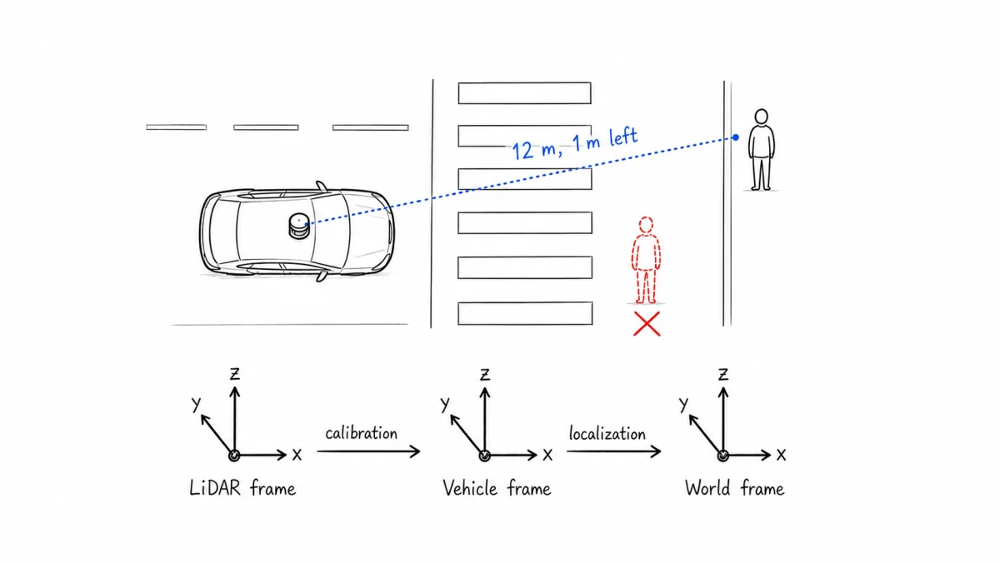
_The same pedestrian detection must travel from the LiDAR frame, through the vehicle frame, and into the world frame before the motion planner can use it._

This is why poses and transforms sit at the foundation of machine perception. We will build the geometry from first principles: how a pose relates two frames, how a rigid transform rotates and translates coordinates, how transforms compose, and how rotation representations affect interpolation and random sampling.

These notes follow Shenlong Wang's _CS 498, Lecture 2: Poses, Coordinates, Transforms and Rotations_.[^lecture] We use **column vectors, right-handed frames, and radians unless degrees are explicitly marked**. The lecture's diagrams are reproduced selectively below, with slide numbers in their captions.

> [!note] The one sentence to remember
> A **pose** tells us where one coordinate frame is located and how it is rotated relative to another frame. A **transform** uses that position and rotation to convert a point's coordinates from one frame into the other.

---

## 0. The Vector Operations We Need

A vector has components, a length, and a direction. A matrix represents a linear transformation of those components. Two operations explain most of the geometry in this note.

The **dot product** measures alignment:

$$
\mathbf a\cdot\mathbf b
=\mathbf a^T\mathbf b
=\|\mathbf a\|\|\mathbf b\|\cos\theta.
$$

For nonzero vectors, the dot product is zero when they are perpendicular, positive when they point generally the same way, and negative when they point generally opposite ways.

The **cross product** in three dimensions gives a vector perpendicular to both inputs:

$$
\|\mathbf a\times\mathbf b\|
=\|\mathbf a\|\|\mathbf b\|\sin\theta,
\qquad
\mathbf a\times\mathbf b=-(\mathbf b\times\mathbf a).
$$

Its magnitude is the area of the parallelogram spanned by the inputs, and its direction follows the right-hand rule. These formulas answer the prerequisite questions on slide 4:

| Relationship between nonzero vectors | Dot product                   | Cross product                                                 |
| ------------------------------------ | ----------------------------- | ------------------------------------------------------------- |
| Perpendicular                        | $0$                           | Perpendicular to both; magnitude $\|\mathbf a\|\|\mathbf b\|$ |
| Parallel, same direction             | $\|\mathbf a\|\|\mathbf b\|$  | $\mathbf0$                                                    |
| Parallel, opposite directions        | $-\|\mathbf a\|\|\mathbf b\|$ | $\mathbf0$                                                    |

A right-handed orthonormal frame satisfies $\mathbf e_x\times\mathbf e_y=\mathbf e_z$. Point your right thumb along a positive rotation axis; the curl of your fingers gives the positive rotation direction. Which axis points forward or upward is a separate convention, not something guaranteed by the words "right-handed."

---

## 1. Coordinate Frames and Poses

A coordinate frame consists of an origin and an ordered set of perpendicular axes. The same physical point has different coordinates in different frames. For example, a pedestrian may be at $(12,1,0)$ in a LiDAR frame but at $(37,-8,0)$ in a world frame. Neither vector is the pedestrian's absolute identity; each is a description relative to a chosen origin and basis.

A rigid body's **pose** combines:

- **position**: where the body-frame origin is located; and
- **orientation**: how the body-frame axes are aligned.

"Rigid" means the distances between points on the object remain fixed. Its pose locates the object at one instant; a full dynamical state may also include velocity.

It helps to start in two dimensions. A car's reference point needs two coordinates $(t_x,t_y)$, and its heading needs one angle $\theta$:

$$
\boxed{\text{2D pose}=(t_x,t_y,\theta).}
$$

These are three **degrees of freedom**, meaning three independently variable quantities. Attaching axes to the car creates its body frame: both the origin and axes move with the car. A point bolted to the car has constant body coordinates even when its world coordinates change.

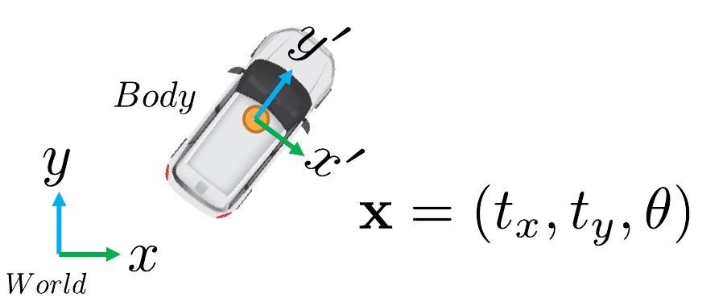
_The car carries a local origin and two axes. Its planar pose needs two translations and one orientation angle. Source: Lecture 2, slide 13.[^lecture] The primed axes in this figure are the body axes; our equations use explicit frame labels._

In three dimensions, a free rigid body has six degrees of freedom: three translations and three rotations. A pose is often represented computationally by a rotation matrix $\mathbf R\in\mathbb R^{3\times3}$ and a translation vector $\mathbf t\in\mathbb R^3$.

For intuition, we can collect the six pose parameters into

$$
\mathbf x
=
\begin{bmatrix}
t_x & t_y & t_z & \alpha & \beta & \gamma
\end{bmatrix}^{T},
$$

where $(t_x,t_y,t_z)$ locate the body-frame origin and $(\alpha,\beta,\gamma)$ denote roll, pitch, and yaw under a chosen Euler-angle convention.

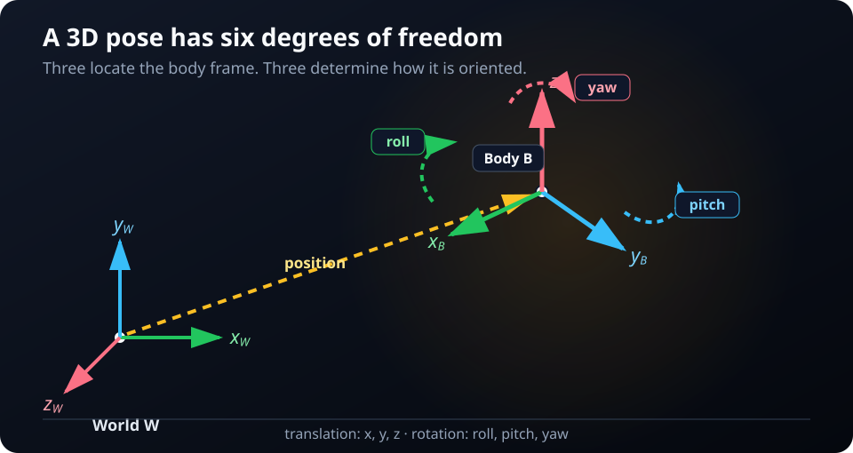
_Figure 1: Translation locates the body-frame origin; roll, pitch, and yaw describe its orientation relative to the fixed world frame._

### 1.1 A notation that prevents frame bugs

Before writing an equation, we need a way to say **which frame a quantity belongs to**. A left superscript names the frame in which coordinates are expressed. Thus,

$$
{}^{B}\mathbf p
$$

means “the coordinates of physical point $\mathbf p$ measured in frame $B$.” The point itself is not changing; the superscript only identifies the coordinate system used to describe it.

For a transform, we need both a source and a destination:

$$
{}^{A}\mathbf T_{B}.
$$

The superscript $A$ is the destination and the subscript $B$ is the source, so ${}^{A}\mathbf T_B$ means “map coordinates from frame $B$ into frame $A$.” We will construct this transform below and introduce its homogeneous matrix form in Section 3.

### 1.2 Building the transformation step by step

Consider a body frame $B$ placed somewhere inside the world frame $W$. We know a point through its body-frame coordinates ${}^{B}\mathbf p$, and we want its world-frame coordinates ${}^{W}\mathbf p$.

**Step 1: locate the body origin.** The translation

$$
{}^{W}\mathbf t_B
$$

is the vector from the world origin to the body origin, expressed using world coordinates. At this stage, we have located frame $B$, but not the point.

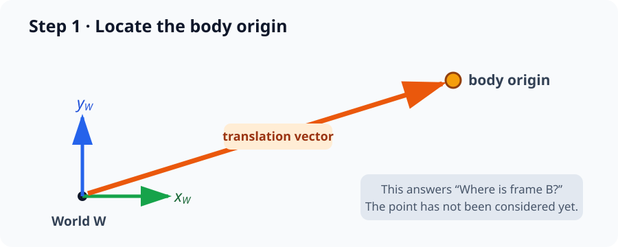
_Step 1: Translation places the body-frame origin relative to the world-frame origin._

**Step 2: describe the point relative to the body.** The vector ${}^{B}\mathbf p$ runs from the body origin to the point, but its components are measured along the body axes. Because the body axes are rotated relative to the world axes, we cannot add this vector directly to ${}^{W}\mathbf t_B$.

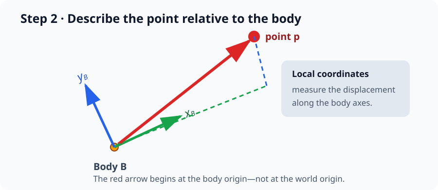
_Step 2: Body-frame coordinates describe the displacement from the body origin to the point._

**Step 3: rotate the local displacement into the world basis.** The rotation ${}^{W}\mathbf R_B$ converts components measured along the body axes into components measured along the world axes:

$$
{}^{W}\mathbf d
= {}^{W}\mathbf R_B\,{}^{B}\mathbf p.
$$

Here, ${}^{W}\mathbf d$ is the same geometric displacement from the body origin to the point, now written in world coordinates. Rotation changes its coordinate components but not its length.

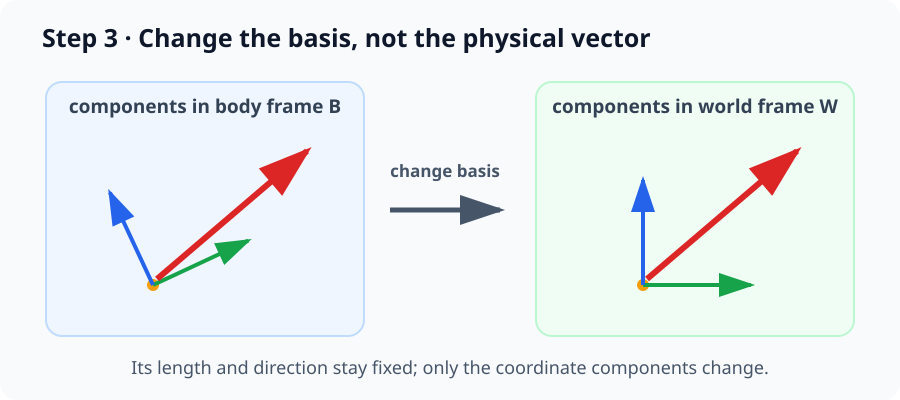
_Step 3: Rotation changes the basis used to describe the displacement; it does not move or resize the vector._

**Step 4: add vectors that now share the same basis.** Both ${}^{W}\mathbf t_B$ and ${}^{W}\mathbf d$ are expressed in frame $W$, so they can be added:

$$
\begin{aligned}
{}^{W}\mathbf p
&= {}^{W}\mathbf t_B + {}^{W}\mathbf d \\
&= {}^{W}\mathbf t_B
 + {}^{W}\mathbf R_B\,{}^{B}\mathbf p.
\end{aligned}
$$

Figure 2 completes the construction by drawing the two world-basis component vectors head to tail. The orange vector reaches the body origin, the red vector continues to the point, and the dashed purple vector is their sum.

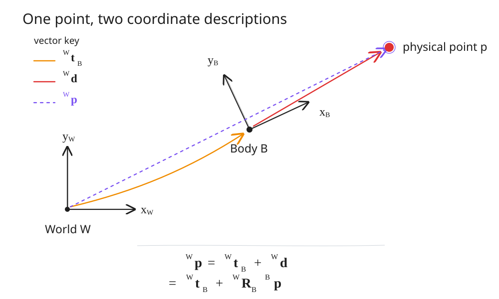

_Figure 2: A body-frame point becomes a world-frame point by rotating its local displacement into the world basis and adding the body origin's world-frame translation._

> [!note] Changing coordinates versus moving a point
> An **active rotation** moves a vector while its reference axes stay fixed. A **passive change of frame** describes the same geometric vector using different axes. Here, the frame-to-frame equations are coordinate conversions. Reversing the conversion requires the inverse rotation. Always identify the input and output frames before choosing a matrix.

---

## 2. Rigid Transforms

Suppose ${}^{B}\mathbf p$ is a point expressed in a body frame $B$. If the orientation of $B$ relative to world frame $W$ is ${}^{W}\mathbf R_B$ and the body origin is located at ${}^{W}\mathbf t_B$, then

$$
\boxed{
{}^{W}\mathbf p
= {}^{W}\mathbf R_B\,{}^{B}\mathbf p
+ {}^{W}\mathbf t_B
}
$$

The order matters:

1. ${}^{W}\mathbf R_B$ rewrites the point using the world-frame basis.
2. ${}^{W}\mathbf t_B$ adds the body origin's world position, so the result is measured from the world origin.

Translation is added after rotation because both terms must already be expressed in the same frame before they can be added.

### 2.1 Deriving the 2D rotation matrix

For a counterclockwise angle $\theta$, the body unit $x$-axis has world components $(\cos\theta,\sin\theta)^T$. The perpendicular body unit $y$-axis has world components $(-\sin\theta,\cos\theta)^T$. Put these vectors in the columns:

$$
{}^{W}\mathbf R_B=\mathbf R(\theta)
=\begin{bmatrix}
\cos\theta&-\sin\theta\\
\sin\theta&\cos\theta
\end{bmatrix}.
$$

Why columns? A point with body coordinates $(p_x,p_y)$ means $p_x$ steps along the body $x$-axis plus $p_y$ steps along the body $y$-axis. Matrix multiplication forms exactly that linear combination of columns. This also explains the columns of a 3D rotation matrix.

Suppose the body is rotated $90^\circ$ counterclockwise, its origin is at world position $(2,1)$, and a point has body coordinates $(2,1)$. Then

$$
\begin{aligned}
{}^{W}\mathbf p
&=\begin{bmatrix}0&-1\\1&0\end{bmatrix}
  \begin{bmatrix}2\\1\end{bmatrix}
  +\begin{bmatrix}2\\1\end{bmatrix}\\
&=\begin{bmatrix}-1\\2\end{bmatrix}
  +\begin{bmatrix}2\\1\end{bmatrix}
=\boxed{\begin{bmatrix}1\\3\end{bmatrix}}.
\end{aligned}
$$

The rotation expresses the body-relative displacement in world axes. The translation then locates that displacement relative to the world origin.

### 2.2 What makes the transform rigid?

A valid 3D rotation satisfies

$$
\mathbf R^T\mathbf R=\mathbf I,
\qquad
\det(\mathbf R)=1.
$$

Orthogonality means that the columns are mutually perpendicular unit vectors. It gives $\mathbf R^{-1}=\mathbf R^T$. For the planar matrix above, writing $c=\cos\theta$ and $s=\sin\theta$ makes the check explicit:

$$
\mathbf R^T\mathbf R
=\begin{bmatrix}c&s\\-s&c\end{bmatrix}
 \begin{bmatrix}c&-s\\s&c\end{bmatrix}
=\begin{bmatrix}c^2+s^2&0\\0&c^2+s^2\end{bmatrix}
=\mathbf I,
\qquad \det\mathbf R=c^2+s^2=1.
$$

It also preserves distances. For two points $\mathbf a$ and $\mathbf b$,

$$
\begin{aligned}
\|\mathbf a'-\mathbf b'\|_2^2
&=\|\mathbf R(\mathbf a-\mathbf b)\|_2^2\\
&=(\mathbf a-\mathbf b)^T\mathbf R^T\mathbf R(\mathbf a-\mathbf b)\\
&=\|\mathbf a-\mathbf b\|_2^2.
\end{aligned}
$$

Translation disappears in the difference, and rotation preserves the remaining norm. Inner products satisfy

$$
(\mathbf R\mathbf u)^T(\mathbf R\mathbf v)
=\mathbf u^T\mathbf R^T\mathbf R\mathbf v
=\mathbf u^T\mathbf v.
$$

Since both lengths and dot products remain unchanged, the cosine of the angle between any two nonzero displacement vectors remains unchanged too.

Orthogonal matrices can have determinant $+1$ or $-1$. The condition $\det(\mathbf R)=1$ rules out reflections, so handedness is preserved. For example, $\operatorname{diag}(-1,1)$ preserves planar distances but reflects across the $y$-axis; it is not a proper rotation.

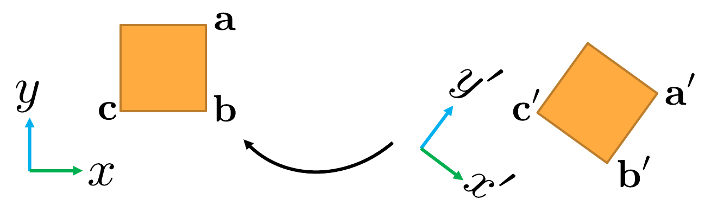
_The square changes position and orientation while corresponding distances, angles, and handedness remain fixed. Source: Lecture 2, slide 19.[^lecture]_

---

## 3. Homogeneous Coordinates

The expression $\mathbf R\mathbf p+\mathbf t$ is affine rather than linear when $\mathbf t\ne\mathbf0$. A linear map sends the origin to the origin; a translation sends it to $\mathbf t$. Homogeneous coordinates absorb the translation into one matrix multiplication by appending an extra coordinate:

$$
{}^{W}\hat{\mathbf p}
=
\begin{bmatrix}
{}^{W}\mathbf p\\1
\end{bmatrix},
\qquad
{}^{W}\mathbf T_B
=
\begin{bmatrix}
{}^{W}\mathbf R_B & {}^{W}\mathbf t_B\\
\mathbf 0^T & 1
\end{bmatrix}.
$$

Then a rigid transform becomes

$$
\boxed{
{}^{W}\hat{\mathbf p}
= {}^{W}\mathbf T_B\,{}^{B}\hat{\mathbf p}
}
$$

In 2D, the same construction uses a $3\times3$ matrix:

$$
\begin{bmatrix}p_x^W\\p_y^W\\1\end{bmatrix}
=
\begin{bmatrix}
\cos\theta&-\sin\theta&t_x\\
\sin\theta&\cos\theta&t_y\\
0&0&1
\end{bmatrix}
\begin{bmatrix}p_x^B\\p_y^B\\1\end{bmatrix}.
$$

In 3D, the $4\times4$ matrix belongs to the special Euclidean group $SE(3)$. Although it stores 12 nontrivial numbers, it has only six degrees of freedom because the nine entries of $\mathbf R$ are constrained.

### 3.1 Points and directions are different

A point uses a final coordinate of $1$:

$$
\hat{\mathbf p}=\begin{bmatrix}\mathbf p\\1\end{bmatrix}.
$$

A direction uses a final coordinate of $0$:

$$
\hat{\mathbf v}=\begin{bmatrix}\mathbf v\\0\end{bmatrix}.
$$

Consequently,

$$
\begin{bmatrix}\mathbf R&\mathbf t\\\mathbf0^T&1\end{bmatrix}
\begin{bmatrix}\mathbf v\\0\end{bmatrix}
=
\begin{bmatrix}\mathbf R\mathbf v\\0\end{bmatrix}.
$$

Translation affects locations, not directions. For a rigid transform this distinction applies to surface normals, ray directions, axis vectors, and the components of a given velocity vector. Relating velocities measured by moving observers requires additional motion terms.

Subtracting two homogeneous points naturally produces a displacement with last coordinate zero:

$$
\begin{bmatrix}\mathbf a\\1\end{bmatrix}
-\begin{bmatrix}\mathbf b\\1\end{bmatrix}
=\begin{bmatrix}\mathbf a-\mathbf b\\0\end{bmatrix}.
$$

---

## 4. Inverting a Transform

If

$$
{}^{A}\mathbf T_B=
\begin{bmatrix}
\mathbf R&\mathbf t\\
\mathbf0^T&1
\end{bmatrix},
$$

then the reverse mapping is

$$
\boxed{
{}^{B}\mathbf T_A
=({}^{A}\mathbf T_B)^{-1}
=
\begin{bmatrix}
\mathbf R^T&-\mathbf R^T\mathbf t\\
\mathbf0^T&1
\end{bmatrix}
}
$$

To derive this, start with $\mathbf p^A=\mathbf R\mathbf p^B+\mathbf t$, subtract $\mathbf t$, and multiply by $\mathbf R^T$:

$$
\mathbf p^B=\mathbf R^T(\mathbf p^A-\mathbf t)
=\mathbf R^T\mathbf p^A-\mathbf R^T\mathbf t.
$$

The translation is **not** merely $-\mathbf t$. The vector must also be expressed in the inverse frame, which is why it becomes $-\mathbf R^T\mathbf t$.

We can verify the result directly:

$$
\begin{bmatrix}\mathbf R&\mathbf t\\\mathbf0^T&1\end{bmatrix}
\begin{bmatrix}\mathbf R^T&-\mathbf R^T\mathbf t\\\mathbf0^T&1\end{bmatrix}
=
\begin{bmatrix}\mathbf I&\mathbf0\\\mathbf0^T&1\end{bmatrix}.
$$

For the 2D example in Section 2.1, reversing the transform recovers the original point:

$$
{}^{B}\mathbf p
=\begin{bmatrix}0&1\\-1&0\end{bmatrix}
\left(\begin{bmatrix}1\\3\end{bmatrix}
-\begin{bmatrix}2\\1\end{bmatrix}\right)
=\begin{bmatrix}2\\1\end{bmatrix}.
$$

Although $\mathbf R^{-1}=\mathbf R^T$, the full transform generally satisfies $\mathbf T^{-1}\ne\mathbf T^T$.

> [!tip] A reliable mental model
> To undo a transform, first undo the translation and then undo the rotation. Matrix multiplication writes those operations in reverse order, producing $\mathbf R^T(\mathbf p-\mathbf t)$.

---

## 5. Composing Coordinate Frames

An autonomous vehicle may contain a LiDAR frame $S$, a vehicle-body frame $B$, and a world frame $W$. Perception returns a pedestrian in the sensor frame, calibration provides the fixed sensor-to-body relationship, and localization estimates the changing body-to-world relationship.

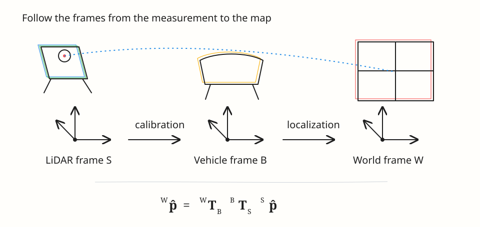
_Figure 3: A sensor measurement reaches the world by following the available frame chain from right to left._

The desired world coordinate is

$$
\boxed{
{}^{W}\hat{\mathbf p}
= {}^{W}\mathbf T_B
  {}^{B}\mathbf T_S
  {}^{S}\hat{\mathbf p}
}
$$

Read the product from right to left: sensor coordinates become body coordinates, then world coordinates. The adjacent frame labels match, just as units must match in a dimensional calculation:

$$
{}^{W}\mathbf T_S
={}^W\mathbf T_B\,{}^B\mathbf T_S.
$$

The lecture uses source-first superscripts: its $\mathbf T^{SB}$ is our ${}^{B}\mathbf T_S$. Thus its $\mathbf T^{BW}\mathbf T^{SB}$ is the same body-to-world after sensor-to-body chain. The labels differ; the physical mapping does not.

More explicitly, if the component transforms are $(\mathbf R_{WB},\mathbf t_{WB})$ and $(\mathbf R_{BS},\mathbf t_{BS})$, their composition is

$$
{}^{W}\mathbf T_S
= {}^{W}\mathbf T_B{}^{B}\mathbf T_S
=
\begin{bmatrix}
\mathbf R_{WB}\mathbf R_{BS}
&
\mathbf R_{WB}\mathbf t_{BS}+\mathbf t_{WB}\\
\mathbf0^T&1
\end{bmatrix}.
$$

Notice that the inner translation $\mathbf t_{BS}$ must be rotated before the outer translation is added. Transform multiplication is generally noncommutative:

$$
\mathbf T_1\mathbf T_2\neq\mathbf T_2\mathbf T_1.
$$

### 5.1 A numerical 2D example

Suppose a sensor is mounted one meter ahead of a vehicle's body origin:

$$
{}^{B}\mathbf t_S=\begin{bmatrix}1\\0\end{bmatrix},
\qquad {}^{B}\mathbf R_S=\mathbf I.
$$

The vehicle is at $(10,5)$ in the world and rotated $90^\circ$ counterclockwise:

$$
{}^{W}\mathbf R_B=
\begin{bmatrix}0&-1\\1&0\end{bmatrix},
\qquad
{}^{W}\mathbf t_B=\begin{bmatrix}10\\5\end{bmatrix}.
$$

A pedestrian detected two meters along the sensor's $x$-axis has ${}^{S}\mathbf p=[2,0]^T$. First map sensor to body:

$$
{}^{B}\mathbf p=\begin{bmatrix}3\\0\end{bmatrix}.
$$

Then map body to world:

$$
{}^{W}\mathbf p
=
\begin{bmatrix}0&-1\\1&0\end{bmatrix}
\begin{bmatrix}3\\0\end{bmatrix}
+
\begin{bmatrix}10\\5\end{bmatrix}
=
\begin{bmatrix}10\\8\end{bmatrix}.
$$

The local phrase "three meters ahead" becomes the world location $(10,8)$ because the vehicle's forward axis points along world $+y$.

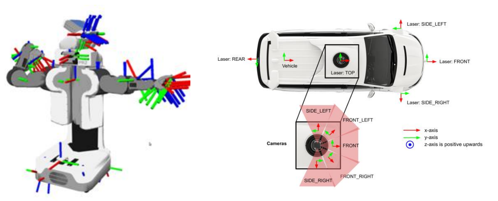
_Real systems have many frames, but every measurement follows the same composition rule along a connected path. Source: Lecture 2, slide 43.[^lecture]_

For a rigidly mounted sensor, the calibration transform is usually fixed. Localization changes the body-to-world transform over time. On an articulated robot, joint motion also changes the transforms between links.

---

## 6. Rotation Matrices and $SO(3)$

The set of valid 3D rotation matrices is

$$
SO(3)=\left\{\mathbf R\in\mathbb R^{3\times3}
\mid \mathbf R^T\mathbf R=\mathbf I,\ \det(\mathbf R)=1\right\}.
$$

The columns of $\mathbf R$ are the source-frame coordinate axes expressed in the destination frame. They are orthonormal and right-handed. "Orthogonal" refers to $\mathbf R^T\mathbf R=\mathbf I$; "special" selects determinant $+1$.

A rotation acts directly on a vector, $\mathbf v'=\mathbf R\mathbf v$. Applying $\mathbf R_1$ first and $\mathbf R_2$ second gives $\mathbf R_2\mathbf R_1\mathbf v$. The order generally matters. Starting from $\mathbf e_x=(1,0,0)^T$:

- Rotate $90^\circ$ about $x$, then $90^\circ$ about $z$: the result is $\mathbf e_y$.
- Rotate $90^\circ$ about $z$, then $90^\circ$ about $x$: the result is $\mathbf e_z$.

### 6.1 What matrices preserve, and why averaging fails

Length preservation follows immediately:

$$
\|\mathbf R\mathbf v\|^2
=\mathbf v^T\mathbf R^T\mathbf R\mathbf v
=\|\mathbf v\|^2.
$$

Proper rotations also preserve the cross product:

$$
(\mathbf R\mathbf a)\times(\mathbf R\mathbf b)
=\mathbf R(\mathbf a\times\mathbf b).
$$

To prove this, take the dot product with $\mathbf R\mathbf c$ for an arbitrary vector $\mathbf c$. The scalar triple product on the left is

$$
\begin{aligned}
\big((\mathbf R\mathbf a)\times(\mathbf R\mathbf b)\big)\cdot\mathbf R\mathbf c
&=\det(\mathbf R)\,(\mathbf a\times\mathbf b)\cdot\mathbf c\\
&=(\mathbf a\times\mathbf b)\cdot\mathbf c.
\end{aligned}
$$

Dot-product preservation gives the same value for $\mathbf R(\mathbf a\times\mathbf b)\cdot\mathbf R\mathbf c$. Since this holds for every $\mathbf c$, the two vectors are equal.

Matrices make vector rotation and composition easy, but store nine numbers for three degrees of freedom. Arbitrary numerical updates can violate their constraints; a matrix generally needs projection back onto $SO(3)$, not just independent normalization of its columns.

Even averaging two valid rotation matrices can fail. Let

$$
\mathbf R_1=\mathbf I,
\qquad
\mathbf R_2=\mathbf R_z(\pi)=\operatorname{diag}(-1,-1,1).
$$

Their average is $\operatorname{diag}(0,0,1)$, which collapses the $x$ and $y$ directions. It is not a rotation. This motivates representations with more convenient interpolation or local updates.

### 6.2 Euler angles and rotation order

Euler angles describe orientation as three sequential elemental rotations. Under the roll-pitch-yaw convention used here,

$$
\boxed{\mathbf R=\mathbf R_z(\gamma)\mathbf R_y(\beta)\mathbf R_x(\alpha),}
$$

where $\alpha$, $\beta$, and $\gamma$ are roll, pitch, and yaw. The elemental matrices are

$$
\mathbf R_x(\alpha)=
\begin{bmatrix}
1&0&0\\
0&\cos\alpha&-\sin\alpha\\
0&\sin\alpha&\cos\alpha
\end{bmatrix},
$$

$$
\mathbf R_y(\beta)=
\begin{bmatrix}
\cos\beta&0&\sin\beta\\
0&1&0\\
-\sin\beta&0&\cos\beta
\end{bmatrix},
\qquad
\mathbf R_z(\gamma)=
\begin{bmatrix}
\cos\gamma&-\sin\gamma&0\\
\sin\gamma&\cos\gamma&0\\
0&0&1
\end{bmatrix}.
$$

For active rotations about fixed axes, the product applies $x$ first, then $y$, then $z$. These are **extrinsic** rotations. The same product can also describe **intrinsic** rotations about moving body axes, in the reverse sequence: first $z$, then the new $y$, then the new $x$.

There are twelve standard three-axis sequences. Six use distinct axes: $XYZ$, $XZY$, $YXZ$, $YZX$, $ZXY$, and $ZYX$. Six repeat the first axis: $XYX$, $XZX$, $YXY$, $YZY$, $ZXZ$, and $ZYZ$. The distinct-axis cases are more precisely called _Tait–Bryan angles_, though Euler angles is often used as an umbrella term.

An angle triple is therefore incomplete without axis order, intrinsic/extrinsic interpretation, and angle units.

### 6.3 Deriving gimbal lock

At pitch $\beta=\pi/2$, the roll-pitch-yaw product simplifies to

$$
\mathbf R=
\begin{bmatrix}
0&\sin(\alpha-\gamma)&\cos(\alpha-\gamma)\\
0&\cos(\alpha-\gamma)&-\sin(\alpha-\gamma)\\
-1&0&0
\end{bmatrix}.
$$

Only the difference $\alpha-\gamma$ remains. Consequently, replacing $(\alpha,\gamma)$ by $(\alpha+\delta,\gamma+\delta)$ leaves the orientation unchanged. Roll and yaw no longer create independent local changes. This is **gimbal lock**.

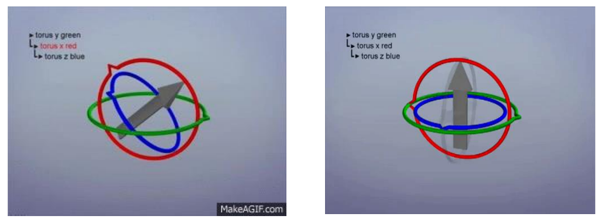
_At the singular configuration, two gimbal axes align and their rotations become dependent. Source: Lecture 2, slide 50.[^lecture] The ring labels in the illustration are specific to that mechanism; the formula above establishes the roll–yaw coupling for our chosen convention._

The statement "increasing roll = decreasing yaw" on slide 51 refers to their effect on $\alpha-\gamma$: either change increases that difference. To keep the orientation unchanged, increase roll and yaw by the **same** amount instead.

> [!important] Gimbal lock is a coordinate singularity
> The rigid body still has three rotational degrees of freedom. At this configuration, the Euler-angle chart cannot describe three independent local changes. Recovering angles or computing updates near the singularity can become unstable even though the physical orientation is perfectly valid.

### 6.4 Axis-angle and the rotation vector

Every proper 3D rotation can be described by a unit axis $\mathbf u$ and an angle $\theta$. The four stored numbers have three degrees of freedom because $\|\mathbf u\|=1$. The **rotation vector**, also called the Euler vector,

$$
\boldsymbol\omega=\theta\mathbf u,
$$

combines them into three numbers: its direction gives the axis and its length gives the angle in radians. A rotation vector is not a triple of Euler angles.

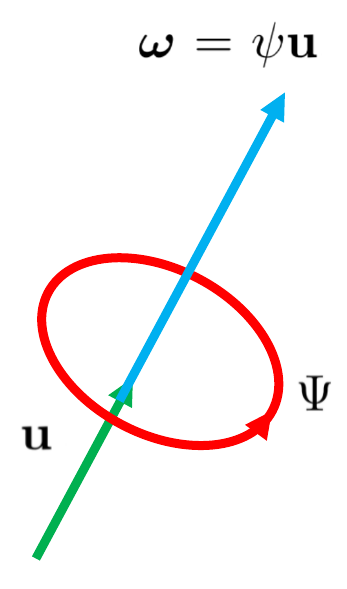
_The rotation vector points along the rotation axis, with magnitude equal to the angle. Source: Lecture 2, slide 52.[^lecture] The figure labels the angle $\psi$ or $\Psi$; the equations here use $\theta$._

Define the skew-symmetric cross-product matrix

$$
[\mathbf u]_\times=
\begin{bmatrix}
0&-u_z&u_y\\
u_z&0&-u_x\\
-u_y&u_x&0
\end{bmatrix},
$$

so that $[\mathbf u]_\times\mathbf v=\mathbf u\times\mathbf v$. **Rodrigues' formula** converts axis-angle to a matrix:

$$
\boxed{
\mathbf R=\mathbf I+\sin\theta[\mathbf u]_\times
+(1-\cos\theta)[\mathbf u]_\times^2.
}
$$

To derive it, decompose a vector into components parallel and perpendicular to the axis:

$$
\mathbf v_\parallel=(\mathbf u^T\mathbf v)\mathbf u,
\qquad
\mathbf v_\perp=\mathbf v-\mathbf v_\parallel.
$$

The parallel component stays fixed. In the perpendicular plane, ordinary 2D rotation gives

$$
\mathbf R\mathbf v
=\mathbf v_\parallel+\cos\theta\,\mathbf v_\perp
+\sin\theta\,(\mathbf u\times\mathbf v).
$$

Substitute the components and collect terms:

$$
\mathbf R\mathbf v
=\cos\theta\,\mathbf v
+(1-\cos\theta)\mathbf u(\mathbf u^T\mathbf v)
+\sin\theta(\mathbf u\times\mathbf v).
$$

Thus $\mathbf R=\cos\theta\,\mathbf I+(1-\cos\theta)\mathbf u\mathbf u^T+\sin\theta[\mathbf u]_\times$. The vector triple-product identity gives

$$
[\mathbf u]_\times^2=\mathbf u\mathbf u^T-\mathbf I,
$$

which produces Rodrigues' formula. The vector expression above also rotates a vector **without constructing a matrix**, so conversion to a matrix is not compulsory as slide 53 suggests.

Axis-angle is not globally unique. $(\mathbf u,\theta)$ and $(-\mathbf u,-\theta)$ give the same rotation; adding $2\pi$ to the angle changes nothing. At zero rotation the axis is arbitrary. At angle $\pi$, opposite axes give the same rotation. A common canonical rotation-vector range is $\|\boldsymbol\omega\|\le\pi$, with opposite boundary points identified.

This explains the slide's "edges" example:

$$
\boldsymbol\omega_1=(0,0,179^\circ)^T,
\qquad
\boldsymbol\omega_2=(0,0,-179^\circ)^T.
$$

Their coordinate difference is $358^\circ$, but the shortest rotation between them is only $2^\circ$. Averaging the vectors gives zero, which is not the midpoint along that short path. Rotation vectors are useful for local updates, but ordinary global subtraction and averaging can cross a coordinate seam.

### 6.5 Unit quaternions

A quaternion has four real components:

$$
\mathbf q=w+xi+yj+zk=(w,\mathbf v),\qquad \mathbf v=(x,y,z).
$$

The imaginary units satisfy $i^2=j^2=k^2=ijk=-1$. For example, $ij=k$ but $ji=-k$, so multiplication is noncommutative. We use **scalar-first** order $(w,x,y,z)$; the lecture's axis-angle tuple uses scalar-last order $(x,y,z,w)$.

The conjugate and inverse are

$$
\mathbf q^*=(w,-\mathbf v),
\qquad
\mathbf q^{-1}=\frac{\mathbf q^*}{\|\mathbf q\|^2}
\quad (\mathbf q\ne\mathbf0).
$$

A unit quaternion satisfies $w^2+\|\mathbf v\|^2=1$, so its inverse equals its conjugate. This unit-norm assumption is needed for the inverse shown on slide 54.

An axis-angle rotation maps to

$$
\boxed{
\mathbf q=\left(\cos\frac{\theta}{2},\mathbf u\sin\frac{\theta}{2}\right).
}
$$

The unit norm follows from $\cos^2(\theta/2)+\sin^2(\theta/2)=1$. A $90^\circ$ rotation about $z$, for example, has scalar-first quaternion $(\sqrt2/2,0,0,\sqrt2/2)$.

For $\mathbf q_1=(w_1,\mathbf v_1)$ and $\mathbf q_2=(w_2,\mathbf v_2)$, the **Hamilton product** is

$$
\mathbf q_1\otimes\mathbf q_2
=\left(
w_1w_2-\mathbf v_1^T\mathbf v_2,
\;w_1\mathbf v_2+w_2\mathbf v_1+\mathbf v_1\times\mathbf v_2
\right).
$$

Embed a vector $\mathbf p$ as a pure quaternion $\mathbf p_q=(0,\mathbf p)$. Then

$$
\boxed{\mathbf p'_q=\mathbf q\otimes\mathbf p_q\otimes\mathbf q^{-1}.}
$$

The vector part is the rotated vector. This two-sided operation produces the full angle $\theta$ from the half-angle terms in $\mathbf q$. Applying $\mathbf q_1$ first and $\mathbf q_2$ second uses $\mathbf q_2\otimes\mathbf q_1$ under this convention.

Quaternions avoid Euler gimbal lock, store only four numbers, and support efficient composition. They still have a unit-norm constraint and a **double cover**:

$$
\boxed{\mathbf q\text{ and }-\mathbf q\text{ represent the same rotation}.}
$$

The two minus signs cancel in the vector-rotation formula. Consequently, a continuous orientation trajectory may acquire artificial sign flips if each quaternion is chosen independently. Keep successive signs consistent and renormalize when numerical error causes norm drift.

### 6.6 Interpolating orientations with SLERP

A useful extension to the lecture is spherical linear interpolation, or **SLERP**. Let $\mathbf q_0$ and $\mathbf q_1$ be unit quaternions. If their dot product is negative, negate one to choose the shorter path. Set

$$
\Omega=\arccos(\mathbf q_0\cdot\mathbf q_1).
$$

For interpolation parameter $s\in[0,1]$,

$$
\mathbf q(s)=
\frac{\sin((1-s)\Omega)}{\sin\Omega}\mathbf q_0
+\frac{\sin(s\Omega)}{\sin\Omega}\mathbf q_1.
$$

The curve stays on the unit-quaternion sphere and gives a shortest rotational path at constant angular speed. When $\Omega$ is very small, use a stable limiting approximation such as normalized linear interpolation. Clamp a numerically computed dot product to $[-1,1]$ before applying $\arccos$.

### 6.7 Choosing a representation

| Representation  | Stored values | Main advantage                       | Main caution                                      |
| --------------- | ------------: | ------------------------------------ | ------------------------------------------------- |
| Rotation matrix |             9 | Direct action and easy composition   | Redundant; must remain orthogonal                 |
| Euler angles    |             3 | Human-readable                       | Order-dependent; gimbal lock                      |
| Axis-angle      |             4 | Geometrically meaningful             | Sign and boundary ambiguities                     |
| Rotation vector |             3 | Convenient local optimization update | Discontinuous at the angle boundary               |
| Unit quaternion |             4 | Stable composition and interpolation | Unit-norm constraint; $\mathbf q\equiv-\mathbf q$ |

A common engineering pattern is to use quaternions or rotation matrices for stored poses, rotation vectors for optimizer updates, and Euler angles only for display.

---

## 7. Uniform Sampling on Curved Spaces

The final slide asks whether uniformly sampled coordinates give uniformly distributed directions or orientations. In both examples the answer is **no**: equal coordinate intervals need not cover equal amounts of geometric area or volume.

### 7.1 Uniform directions on the sphere

With azimuth $\phi\in[0,2\pi)$ and polar angle $\theta\in[0,\pi]$, a unit direction is

$$
\mathbf d=
\begin{bmatrix}
\sin\theta\cos\phi\\
\sin\theta\sin\phi\\
\cos\theta
\end{bmatrix}.
$$

Here $\theta$ is measured down from the positive $z$-axis. The slide calls it latitude, but its interval corresponds to **polar angle**, not geographic latitude.

The sphere's area element is

$$
dA=\sin\theta\,d\theta\,d\phi.
$$

Near a pole, a fixed angular rectangle covers less area than near the equator. Uniformly sampling both angles therefore produces too many samples near the poles per unit area.

Instead, sample $z\sim U(-1,1)$ and $\phi\sim U(0,2\pi)$ independently, then set

$$
\boxed{
\mathbf d=
\begin{bmatrix}
\sqrt{1-z^2}\cos\phi\\
\sqrt{1-z^2}\sin\phi\\
z
\end{bmatrix}.
}
$$

Why does this work? Since $z=\cos\theta$, the area element becomes $|dz|\,d\phi$. Equal-height strips of a sphere have equal area. Another valid method is to normalize a vector of three independent standard normal samples: its rotationally symmetric distribution has no preferred direction.

### 7.2 Uniform rotations in $SO(3)$

A random direction is not a full random orientation: after choosing where one axis points, rotation about that axis is still free. Nor does sampling roll, pitch, and yaw independently and uniformly yield uniform orientations.

For $\mathbf R=\mathbf R_z(\gamma)\mathbf R_y(\beta)\mathbf R_x(\alpha)$ with $\beta\in[-\pi/2,\pi/2]$, the uniform rotation measure is proportional to

$$
\cos\beta\,d\alpha\,d\beta\,d\gamma.
$$

One valid sampler draws roll and yaw uniformly over a full turn, samples $s\sim U(-1,1)$, and sets $\beta=\arcsin s$.

An especially simple alternative uses unit quaternions:

1. Draw four independent standard normal samples $g_0,g_1,g_2,g_3$.
2. Form $\mathbf g=(g_0,g_1,g_2,g_3)$.
3. Normalize: $\mathbf q=\mathbf g/\|\mathbf g\|$.
4. Interpret $\mathbf q$ as a unit quaternion.

The normalized Gaussian is uniform on the three-dimensional unit sphere $S^3$ in four-dimensional space. Its quaternion-to-rotation mapping produces the uniform, or **Haar**, distribution on $SO(3)$. The two-to-one mapping is harmless because every rotation has exactly the pair $\mathbf q,-\mathbf q$.

> [!note] Normalize Gaussian samples, not uniform cube samples
> Normalizing four samples from $U(-1,1)$ does not give the same distribution. A Gaussian is rotationally symmetric; a cube is not. The same distinction applies when sampling directions on $S^2$.

---

## 8. Implementation Pattern

The following NumPy functions encode the same frame convention used throughout this note:

```python
import numpy as np


def make_transform(R: np.ndarray, t: np.ndarray) -> np.ndarray:
    """Construct destination_T_source from destination_R_source and destination_t_source."""
    T = np.eye(4)
    T[:3, :3] = R
    T[:3, 3] = t
    return T


def invert_transform(A_T_B: np.ndarray) -> np.ndarray:
    """Return B_T_A."""
    R = A_T_B[:3, :3]
    t = A_T_B[:3, 3]

    B_T_A = np.eye(4)
    B_T_A[:3, :3] = R.T
    B_T_A[:3, 3] = -R.T @ t
    return B_T_A


def transform_point(A_T_B: np.ndarray, B_p: np.ndarray) -> np.ndarray:
    """Map a 3D point from frame B to frame A."""
    B_p_h = np.append(B_p, 1.0)
    return (A_T_B @ B_p_h)[:3]


def is_rotation_matrix(R: np.ndarray, atol: float = 1e-7) -> bool:
    return (
        np.allclose(R.T @ R, np.eye(3), atol=atol, rtol=0.0)
        and np.isclose(np.linalg.det(R), 1.0, atol=atol, rtol=0.0)
    )
```

For valid rigid-transform inputs, the following example checks composition, inversion, point-versus-direction behavior, and distance preservation:

```python
W_T_B = make_transform(
    np.array([[0., -1., 0.], [1., 0., 0.], [0., 0., 1.]]),
    np.array([10., 5., 0.]),
)
B_T_S = make_transform(np.eye(3), np.array([1., 0., 0.]))
S_p = np.array([2., 0., 0.])
W_T_S = W_T_B @ B_T_S
W_p = transform_point(W_T_S, S_p)

assert np.allclose(W_p, [10., 8., 0.])
assert np.allclose(W_T_S @ invert_transform(W_T_S), np.eye(4))
assert np.allclose(transform_point(invert_transform(W_T_S), W_p), S_p)
assert is_rotation_matrix(W_T_S[:3, :3])

# The last homogeneous coordinate controls whether translation applies.
assert np.allclose(W_T_B @ [1., 0., 0., 0.], [0., 1., 0., 0.])
assert np.allclose(W_T_B @ [1., 0., 0., 1.], [10., 6., 0., 1.])

S_p2 = np.array([-1., 2., 4.])
assert np.isclose(
    np.linalg.norm(transform_point(W_T_S, S_p) - transform_point(W_T_S, S_p2)),
    np.linalg.norm(S_p - S_p2),
)
```

The sampling algorithms need only NumPy as well. The returned quaternion order below is scalar-first `(w, x, y, z)`:

```python
rng = np.random.default_rng(42)


def sample_unit_vectors(rng, count: int, dimension: int) -> np.ndarray:
    samples = rng.normal(size=(count, dimension))
    norms = np.linalg.norm(samples, axis=1, keepdims=True)
    # Exact zeros have probability zero in the ideal distribution;
    # resample them defensively for finite-precision computation.
    zero = norms[:, 0] == 0
    while np.any(zero):
        samples[zero] = rng.normal(size=(np.count_nonzero(zero), dimension))
        norms = np.linalg.norm(samples, axis=1, keepdims=True)
        zero = norms[:, 0] == 0
    return samples / norms


directions = sample_unit_vectors(rng, count=1000, dimension=3)
quaternions_wxyz = sample_unit_vectors(rng, count=1000, dimension=4)
```

> [!warning] Library conventions differ
> Before combining libraries, check axis handedness, quaternion component order (`wxyz` versus `xyzw`), angle units, Euler order, whether vectors are rows or columns, and whether a matrix maps source-to-destination or destination-to-source. Shape compatibility alone does not prove semantic compatibility.

---

## 9. Check Your Understanding

Try these before reading the answers:

1. A body has no rotation, its origin is at world position $(5,2)$, and a point has body coordinates $(1,3)$. What are the world coordinates?
2. What changes about a direction vector under pure translation?
3. If ${}^{A}\mathbf T_B$ maps $B$ to $A$ and ${}^{B}\mathbf T_C$ maps $C$ to $B$, what maps $C$ to $A$?
4. Why does the inverse translation include $\mathbf R^T$?
5. At pitch $\pi/2$, what happens if roll and yaw both increase by the same amount?
6. Do $\mathbf q$ and $-\mathbf q$ encode different orientations?
7. Why is uniform sampling of polar angle biased toward the poles?

**Answers.** (1) $(6,5)$. (2) Its components do not change. (3) ${}^{A}\mathbf T_B{}^{B}\mathbf T_C$. (4) The reversed displacement must be expressed in the reversed frame. (5) The orientation stays unchanged because $\alpha-\gamma$ stays constant. (6) No. (7) Equal angular intervals cover less surface area near the poles.

---

## 10. Summary

The geometry of machine perception rests on a small set of reusable ideas:

1. Coordinates are meaningless without a frame.
2. A pose relates two frames through orientation and position.
3. A rigid transform maps source-frame coordinates into a destination frame.
4. Homogeneous coordinates unify rotation and translation.
5. Transform labels determine composition order; matching inner frames should cancel.
6. Inversion uses $\mathbf R^T$ and $-\mathbf R^T\mathbf t$, not a simple matrix transpose.
7. Rotation matrices, Euler angles, axis-angle vectors, and quaternions describe the same geometry with different tradeoffs.
8. Interpolation and random sampling must respect rotation geometry; coordinate averages and uniform angle samples can give the wrong result.

Once the notation is disciplined, a complicated multi-sensor system becomes a graph of frames connected by transforms. Perception supplies measurements, calibration connects sensors to the platform, and localization connects the platform to the world.

---

## References

[^lecture]: Wang, Shenlong (2026). _CS 498 Fall 2026, Lecture 2: Poses, Coordinates, Transforms and Rotations_. University of Illinois Urbana-Champaign, August 28, 2026. The reproduced figures are cropped from slides 13, 19, 43, 50, and 52 of the supplied lecture PDF. The deck credits borrowed materials to Matthew O’Toole, Kris Kitani, Lana Lazebnik, Derek Hoiem, and Sanja Fidler; original image marks are retained where present.

- [3D Rotations - Robotic Systems](http://motion.cs.illinois.edu/RoboticSystems/3DRotations.html).
- [Visualizing Quaternions](https://eater.net/quaternions/).
